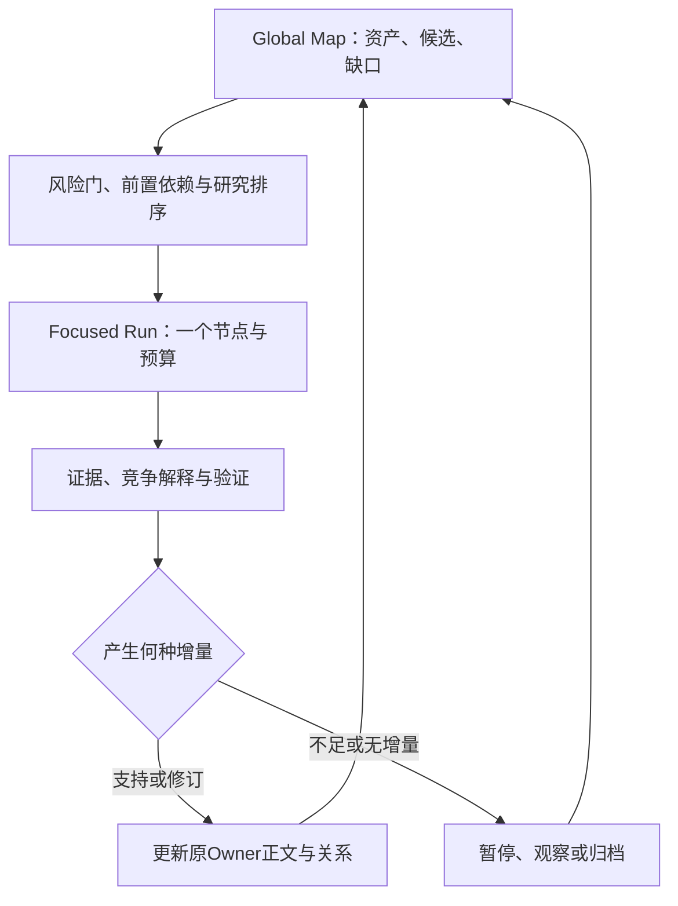

# VizTell 全局知识宇宙地图与跨域关联（R2 / V0.2）

> **唯一职责**：全局入口、对象边界、既有资产归属、组织方案及跨域引用纪律。候选与排序只维护在 [01](01_全局宇宙候选与研究优先级.md)，因素与关系只维护在 [02](02_跨宇宙因素与关系索引.md)，研究运行只维护在 [续研协议](思维与方法宇宙/03_跨宇宙多维推理与节点续研协议.md)。
>
> **稳定入口**：本文件；版本 R2，2026-11-22（北京时间）。状态：可执行的文档架构与候选地图，已核验范围见 [R2 验收记录](03_全局路由样例与R2验收.md)。不是世界知识穷尽清单，也不是已经证成的规律库。后续由全局地图维护职责更新路由；专业正文仍由各领域维护。

## 1. 本轮决定

采用 **独立宇宙 + 类型化登记 + 多维研究坐标 + 有证据状态的关系**。文件目录用于确定正文责任；分类视图帮助发现；关系描述跨域连接；研究任务决定当下深入哪里。四者不压成一棵树。

本轮建立“跨宇宙因素与关系索引”，不新建一个包揽所有领域定义的“元因素宇宙”。“元因素”仅表示候选具有跨域复用价值，不能据此推定它在所有领域都同义、同向或具有强因果作用。索引 ID 可稳定，候选解释仍可被否定。

**先看到全局，再决定局部；先识别已有知识，再新增结构；先判断价值，再投入深挖；先取得证据，再宣称规律。**

## 2. 真实仓库基线与既有资产

### 2.1 本轮读取基线

- VizTell：`main` = `b99ddf5f74bef4ebec9b5790cb46ded95a765827`；tree = `90bc127ae9fddc54982780f01a876976a3b925e6`。这次远端读取与用户给出的上一轮基准一致，不能把这种一致当作下轮默认。
- 递归树未截断：705 个树条目，其中 577 个文件；`docs/` 有 302 个文件、11 个一级知识资产目录，加本全局入口文件。计数描述**修改前快照**，不是已通读或已验证的知识数。
- 读取全部11目录入口、用户指定正文、商业与营销当前有效入口、营销领域 Registry、知识对象与关系 Schema、既有知识宇宙构建流程；未把所有原子和案例重新研究一遍。
- AI人生系统（只读）：`main` = `16bd759782f20236d577282a869aa18b370f3e4f`；本轮只读框架、人的因素、幸福因素登记与研究规范，不访问个人档案。来源固定版本见第7节。
- VizTell 树中没有 `AGENTS.md`。本轮目标仓库为 VizTell；OpenDesk 项目背景不改变写入目标。

### 2.2 保留的11个独立知识资产

“知识资产”比“宇宙目录”更宽：没有在名称里写宇宙，也不能被漏掉或降为别人的附属目录。

| 资产及稳定入口 | 修改前文件数 | 已有正文责任与本次核验 | 与邻域的边界 |
| --- | ---: | --- | --- |
| [社会运行规则宇宙](社会运行规则宇宙/README.md) | 1 | V0.1；SR-001—SR-012 候选社会机制 | 资源、利益、权力、互动、制度；不拥有所有行业事实 |
| [周期与演化宇宙](周期与演化宇宙/README.md) | 1 | V0.1；周期、生命周期、路径依赖、结构转换 | 动态模型与时间证据；不把变化都称为周期 |
| [软件IT失败宇宙](软件IT失败宇宙/README.md) | 1 | V0.1；IT-01—IT-10，含产品、采用、商业、技术、安全与组织 | IT 专业失效；与项目失败平行，不被其吞并 |
| [企业项目失败宇宙](企业项目失败宇宙/README.md) | 1 | V0.1；跨行业项目的价值、阶段门、交付、治理和退出 | 不把企业破产、每个项目失败、技术故障混为一个结果 |
| [商业模式宇宙](商业模式宇宙/README.md) | 111 | [当前入口](商业模式宇宙/00_导航与总览/00_当前有效版本与加载入口.md)：v4 本体 + runtime-v1 + 项目商业推理工作流；入口记载 U01—U27 / 676 原子 / 200 模式 / 40 商品角色 | 本轮核对入口口径，未逐条审计676原子；价值交换、收入/成本/利润结构不另抄到营销或因素表 |
| [营销宇宙](营销宇宙/README.md) | 56 | [有效入口](营销宇宙/00_导航与总览/00_当前有效版本与加载入口.md) 为 v0.9；D01—D24专业归属及增长运营架构 | 需求、产品价值、战略、竞争、渠道、客户生命周期已有 Owner；v0.9 自身仍注明专业复核和真实验证缺口 |
| [思维与方法宇宙](思维与方法宇宙/00_总览与分类地图.md) | 14 | 28个方法族，含因果、概率、测量、系统、决策、风险、学习与博弈 | 负责“怎样研究和判断”；具体人的行为规律不是方法目录自动拥有的一切 |
| [通用链路宇宙](通用链路宇宙/00_总览与核心结论.md) | 23 | C01—C30、L3/L4；[A—H / 30维深挖框架](通用链路宇宙/19_链路垂直深挖与审计框架.md)已存在 | 负责状态转换和任务装配；本轮不新增C31或重写深挖体系 |
| [AI原生知识系统](AI原生知识系统/00_总览与核心框架.md) | 88 | Raw / Atom / Canonical / Relation；去重、证据、价值与消费治理 | [16](AI原生知识系统/16_知识原子、标准知识与关系模型.md)仍是知识对象与关系权威；研究优先级不覆盖其真假、学习、消费判断 |
| [AI人机协作质量](AI人机协作质量/01_高频问题现象宇宙.md) | 3 | 现象、问题根因、专业框架三个互补文件 | 是已有独立资产；与 IT 失败/知识系统交叉，但协作质量正文不迁走 |
| [专业建模与表征](专业建模与表征/00_总览与边界.md) | 2 | M1—M4：语言/图族/视图/元素 | 原文明确独立于思维方法；UML等专业表示不能只因有助思考就并入方法清单 |

另有 [知识宇宙构建工作流](../workflows/知识宇宙构建/README.md)（S1—S8，候选 V1），负责从零碎种子构建领域地图；本轮 Global Map 负责全局选择与联邦路由，Focused Run 负责有界续研。它们互为接口，不另造相同流程。`scripts/`是维护工具，`temp/`是来源与中间材料，均不按目录数量计作宇宙。

## 3. 全局候选版图：发现视图，不是单一上下级

以下区域允许相交。详表包含已有、建议独立、专业子域、推理维度、因素机制、案例集合、暂缓等状态，见 [候选与优先级登记](01_全局宇宙候选与研究优先级.md)。登记不等于建立目录。

| 发现区域 | 必须能发现的知识群 | 本轮路由原则 |
| --- | --- | --- |
| 形式与物质基础 | 数学、逻辑、概率、统计、测量、信息、物理、化学、材料、能源、宇宙与地球 | 方法工具链接现有方法；专业规律保留独立候选，不塞入社会规则 |
| 生命与环境 | 生物、遗传、演化、生态、气候、环境、农业、食物、资源与可持续性 | 自然系统机制不同于人的意图；生命周期和“生物演化”不可仅凭同名合并 |
| 人与个体 | 生理健康、心理、认知、行为、学习、能力、动机、个人发展、决策与关系 | 方法/经验机制/个人结果三种路由；十维人生系统仅负责个人结果 |
| 社会与制度 | 交换、竞争合作、权力、社会结构、网络、文化、法律、伦理、公共治理、安全 | 社会机制复用社会规则；规范性判断与事实性因果分开 |
| 经济与商业 | 宏观经济、金融与资本、市场、战略、企业、组织、商业模式、产品、用户、营销、运营与供应链 | 商业与营销已有资产优先；宏观/组织等超出边界的专业问题可独立登记 |
| 技术与创造 | 计算、软件、AI、工程、制造、基础设施、研发、设计、技术替代与创新 | 正常设计知识不能全塞失败宇宙；专业表征、IT失败保留独立责任 |
| 历史、空间与意义 | 历史、地理、人口、文明、语言、传播、哲学、宗教、艺术与审美 | 不因短期商业回报低就排除；用各自的证据、解释和规范标准 |
| 动态、经验与研究 | 周期、阶段、反馈、尺度、成功/失败/挽救、方法、科学验证、决策与行动 | 动态宇宙与研究坐标并存；成功/失败是案例结果标签，不能复制所有行业百科 |

外部覆盖校准采用 [OECD Frascati Manual 2015 表2.2](https://www.oecd.org/content/dam/oecd/en/publications/reports/2015/10/frascati-manual-2015_g1g57dcb/9789264239012-en.pdf) 的自然科学、工程技术、医健、农业兽医、社会科学、人文学艺术六类作为遗漏检查。它是 R&D 统计分类，**不是穷尽世界知识的本体**；生活实践、隐性知识、规范、文化意义仍需另行检查。

## 4. 对象类型：不同问题用不同对象回答

| 类型 | 身份与判定 | 例子 / 容易混淆处 |
| --- | --- | --- |
| Universe 独立研究宇宙 | 有独立问题族、专业边界、证据制度和持续维护责任 | IT失败与项目失败可交叉却独立；宇宙不是最高抽象真理 |
| Domain 专业领域 | 专业问题/实践范围；可跨宇宙、也可在一个宇宙中分域 | 营销D04需求发现；Domain不自动升格成目录 |
| Factor 因素/变量 | 在指定单位、人群、环境和时间下可区分取值的属性 | 可用现金、需求紧迫度；“利益”须操作化为谁的预期得失 |
| Mechanism 机制 | 条件下状态如何经过程、中介、互动改变结果 | 竞争威胁如何影响回应选择；不是几个名词的连线 |
| Principle 原理 | 带边界、例外、证据状态的一般命题 | 有限互斥用途才有相应机会成本；候选不是已证定律 |
| Cycle / Dynamics 动态 | 对象随时间的变化模式及解释 | 周期/趋势/生命周期/冲击分开；重复性需数据检验 |
| Case 案例 | 有明确事件身份、时间线、来源和结果的实例 | 一个Stadia事件可被多宇宙解释，但原始证据不复制 |
| Method 方法 | 研究、推理或判断的可重复操作 | 因果识别、逆推、参考类比较；不是专业结果 |
| Workflow 工作流 | 有输入、状态、角色、关口、输出与退出的执行装配 | 一轮Focused Run；复用通用链路 |
| Outcome 结果 | 被解释/评价的目标状态，须说明主体、期限、基准 | 采用、利润、健康、学习收益各有Owner，不等价 |
| Decision Rule 决策规则 | 指定目标、证据及约束下的条件行动建议 | 何时试验/转向/暂停；研究优先不自动授权行动 |
| Metric / Evidence 指标与证据 | 指标是测量规则；证据是支持或反驳具体主张的观测/材料 | 用户数是测量，带口径的数据才可能成为证据；来源可信不等于因果已识别 |

Factor等是研究登记的角色 profile，沿用已有 Concept、Claim、Mechanism、Case 等知识对象。本文不擅自扩展机器 Schema enum；实际序列化必须按现有 Schema 或单独版本化扩展。某指标在特定模型中可作解释变量，但须新建**有语境的使用关系**，不能静默变更概念身份。

## 5. 四种组织方案比较

以下为设计取舍，不是经实验测量的评分。

| 方案 | 覆盖 | 去重 | 可扩展性 | 维护成本/局限 | 决定 |
| --- | --- | --- | --- | --- | --- |
| A 独立领域平行目录 | 专业边界直观 | 同机制易重复 | 开目录容易，横跨问题难导航 | 目录和同义正文易增长 | 保留其正文Owner原则 |
| B 底层机制—领域应用—证据案例 | 理论到应用阅读清楚 | 集中机制有利去重 | 同对象跨层、双向作用难表示 | 容易强造母宇宙、无限抽象 | 作为阅读视图，不作唯一归属树 |
| C 独立宇宙+坐标+关系 | 多重归属、时间、冲突可表达 | 稳定ID和一份正文 | 新节点先登记，按需建内容 | 关系必须有类型、条件、证据与Owner | **主结构**，当前用Markdown即可 |
| D 现实问题/决策驱动网络 | 容易产生行动价值 | 不接Canonical会重复知识 | 随问题扩展 | 可能忽略基础领域与非功利价值 | 用作Focused Run，回写C的Global Map |

不建图数据库，不批量造空目录，不把所有因素放入一个高层理论文件。知识图谱在本轮指**可追踪的类型化关系记录**，没有自动推理或检索软件上线。

## 6. 独立性、Owner与关系纪律

### 6.1 独立候选须证明六件事

稳定对象与边界；持续问题族；独特的机制组合或证据方法；实际非重复资产或首个有界研究任务；相邻宇宙的重叠/排除路由；维护职责与复核触发。

独立性不要求完全无交叉。候选通过独立性审查后，仍须具备真实正文、Owner承接和最小验收任务才创建目录。未完成承接写 `proposed / owner_unassigned`；不能为填表把自然物理、医学等暂归社会规则。已有独立资产继续保留，只有证明定义、问题、证据和维护责任实际重复后，才讨论有迁移记录的合并。

### 6.2 每种职责唯一，不等于一个宇宙拥有一切

| 职责 | 唯一记录位置 | 允许的跨域关系 |
| --- | --- | --- |
| 身份与别名 | 因素登记/既有Canonical ID | 多个专业使用者引用，不重复编号 |
| 专业语义与机制 | 对应宇宙的权威正文 | 可有不同作用范围的竞争解释 |
| 事件事实/来源 | 一份有来源定位的Case/Evidence记录 | 多分析ID共享case_id/source_id |
| 结果及评价 | 该项Outcome的领域Owner | 多结果各有Owner，不能把钱、学习、健康压成一个结果 |
| 风险、资源、研究状态 | 各自一份职责记录 | 同一文档可兼任多个职责；不要求新文件 |

未承接的专业Owner不得静默视为已任命维护者。本文的Owner是文档/职责位置，不代表已聘任专家或给真实人员布置工作。

### 6.3 关系分族，关联不等于因果

- 概念：别名、上下位、交叉、相关；不能因同名自动合并。
- 证据：支持、削弱、冲突、反例；都要指向具体命题。
- 来源与版本：派生、修订、原始来源；旧ID保留，不循环复用。
- 使用与任务：方法调用、领域归属、时间阶段、依赖；属于导航或运行上下文。
- 因果：通过单独条件化Claim/Mechanism及证据表达，关系必须包含作用范围、方向、时滞、竞争解释；没有证据保持候选。

此前V0.1的 `belongs_to_domain / uses_method / occurs_during / influences` 等是导航语义，不是现有 `relation-assertion.schema.json` 的已支持枚举。本轮不把它们直接送入现有Schema。可序列化断言、文档限定语及兼容方式见 [02](02_跨宇宙因素与关系索引.md)。

上述借鉴 [W3C SKOS §8/§10](https://www.w3.org/TR/skos-reference/) 的层级、关联和跨体系映射区分，以及 [W3C PROV-O §3.1](https://www.w3.org/TR/prov-o/) 的实体、活动、责任主体区分；没有宣称完整实现这些标准。特别是近似匹配不应通过多次连接自动变成等价。

## 7. AI人生系统：只读联邦引用

参考固定版本 `16bd759782f20236d577282a869aa18b370f3e4f`：

- [五类主对象与目录职责](https://github.com/shopable-ai/ai-life-system/blob/16bd759782f20236d577282a869aa18b370f3e4f/00_framework/14_五类主对象与目录职责规范.md)：十维是个人结果域，不是世界知识分类。
- [因素宇宙契约](https://github.com/shopable-ai/ai-life-system/blob/16bd759782f20236d577282a869aa18b370f3e4f/00_framework/18_因素宇宙契约与跨维实例化规范.md)：借鉴身份状态、证据状态、行动权限分离及分职责Owner。
- [人性与反人性路由](https://github.com/shopable-ai/ai-life-system/blob/16bd759782f20236d577282a869aa18b370f3e4f/00_framework/19_人性与反人性概念边界与跨维路由.md)：不把一切困难归因于人性。
- [跨维能力治理](https://github.com/shopable-ai/ai-life-system/blob/16bd759782f20236d577282a869aa18b370f3e4f/00_framework/10_跨维知识资产能力治理矩阵.md)与[本质追问与关系核验](https://github.com/shopable-ai/ai-life-system/blob/16bd759782f20236d577282a869aa18b370f3e4f/00_framework/23_本质追问与关系核验方法.md)：按判断增量、证据和边界继续研究。
- [人的因素宇宙](https://github.com/shopable-ai/ai-life-system/blob/16bd759782f20236d577282a869aa18b370f3e4f/00_foundations/01_human_context/02_人的因素宇宙.md)：核对15个一级类别；[幸福因素总表](https://github.com/shopable-ai/ai-life-system/blob/16bd759782f20236d577282a869aa18b370f3e4f/03_happiness/10_research/20_factor_universe/00_幸福因素宇宙总表.md)：核对18领域、144唯一ID，全部S2-WORKING。数量是覆盖事实，不是因果证明。

参考库也有历史格式差异：幸福旧表存在多角色并列、Owner多路径；后出的框架18要求单一主角色及分职责Owner。本轮复用后者治理，不复制旧表，不修参考库。

**跨仓引用字段只在此定义**：`repo / commit / path / anchor_or_id / source_role / reused_contract / last_checked / review_trigger`。前四项准确定位来源；`source_role`说明来源承担事实、定义还是治理参考；`reused_contract`说明仅复用了哪些规则。各Run可直接引用本记录，不复制同一合同。定义/ID/Owner变化后的使用时核对、局部暂停与恢复，统一按[续研协议§7.4](思维与方法宇宙/03_跨宇宙多维推理与节点续研协议.md)执行，没有隐含自动同步。

## 8. 从全局返回一个有价值的问题

下一阶段只开展 [R2 验收记录](03_全局路由样例与R2验收.md)指定的一个 Focused Run；其他候选保留在地图，只有影响当前决策或满足复核触发才展开。重复表达、文件增加、关系连线增加都不是研究进展。
