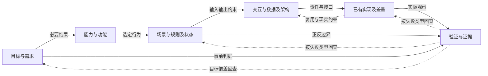
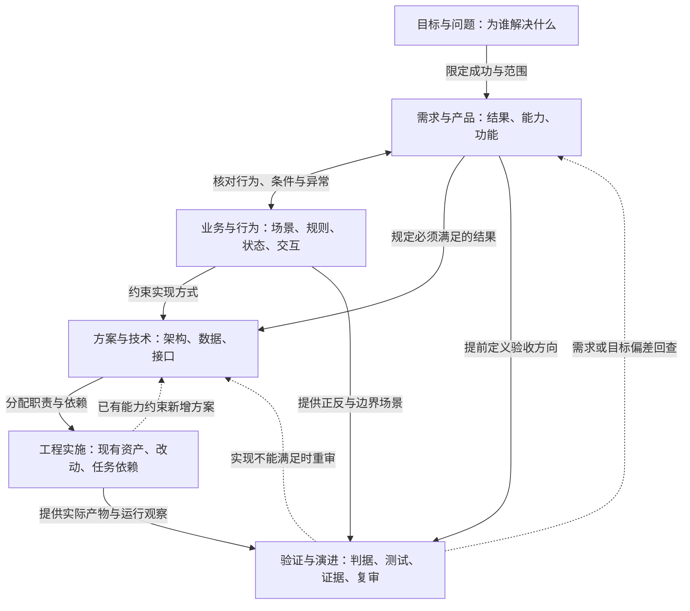

# 工程模型总体框架与实际应用

> **当前：R1-B.2｜2026-11-26｜候选使用方法。** 已形成六类任务选择主表、决策关系与真实历史对照，并补查项目知识恢复与 OS 实际成熟度；R1-B.2 尚未退出，独立使用、增量价值、成本与正式接入未证实。R1-B.1 总体地图与连播助手静态分析保留为历史参考；评分及唯一下一任务见 [90](90_研究缺口与续研任务.md)。

**工程模型的作用，是让 AI 说清楚：为什么做、必须满足什么、产品怎样行为、由什么实现、怎样证明有效。** 使用时先找当前决定缺少的知识，再选择模型；已有需求、代码、测试和记录可以直接成为模型的载体，不必另建一套文件。

这里的模型是对某个工程问题的结构化表达。树、图和表是可选表示方式；代码与测试可以提供已有实现和验证义务的事实，不能只凭文件名判断已经建模或完成验证。

本页优先回答工程模型怎样使用。整个研发体系的导航仍见 [00 总体框架与关键结论](00_AI原生研发总体框架与关键结论.md)。

<a id="当前使用方法r1-b2先决定再选择知识"></a>

## 当前使用方法（R1-B.2）：先决定，再选择知识

**不先建立模型全集。** 工程模型是为工程决定提供知识的结构；先明确决定，查已有事实，补足影响决定的缺口，形成最小可验证差量。沿用 §2 六组知识，不新增模型分类或研发阶段。

| 研发任务 | 要作出的决定 | 必须理解或按需展开的知识 | 首选已有知识来源 | 最小输出 |
| --- | --- | --- | --- | --- |
| 从零设计产品 | 为谁解决什么？第一版有哪些必要结果，选何方案？ | 目标、角色、需求、场景、能力/功能、规则、验收；按风险补交互、架构、数据、状态、权限 | 原始请求、业务/用户资料、技术约束；无事实时标未知 | 需求/能力范围、关键行为、候选设计、判据及待决问题 |
| 为存量产品新增功能 | 已有能力能否满足？扩展何入口？什么不能变？ | 目标/需求、能力/功能、触发场景、实现、测试；跨模块时查接口、状态和数据 | 项目地图、需求卡、UI、源码调用链、测试 | 复用/配置/修改/新增决定、责任边界、回归条件 |
| 修改业务规则 | 新旧结果在哪些条件不同？谁受影响？ | 场景、规则、状态、优先级、消费者、验收；有存量数据时查版本/迁移 | 规则、决策、实现、存储、边界测试 | 规则差量/决策表、反例、兼容条件与影响位置 |
| 修复缺陷 | 期望与观察差异在哪里？缺规则、状态、实现还是证据？ | 目标、复现、实际路径、相关规则/状态、实现与回归；外部动作查回执和恢复 | 用户报告、日志、测试、源码、变更记录 | 可证伪根因或假设、局部修改范围、复现和回归判据 |
| 调整 UI/交互 | 用户怎样操作？哪些反馈和行为不能改坏？ | 交互、场景、输入输出、既有组件、验收；行为变化时补状态、数据或接口 | 当前 UI、规范、原型、组件、观察和测试 | 界面差量、交互/可访问性判据、不变业务行为 |
| 修改架构、数据或接口 | 如何分责？契约、消费者、兼容、迁移与故障如何处理？ | 目标/质量约束、架构/接口、数据、依赖、实现、证据；按需查权限、部署、并发、回滚 | ADR、模块图、API契约、schema、调用方、部署/测试记录 | 影响范围、候选方案/ADR、兼容迁移计划、验证条件 |

### 五个选择问题与停止规则

1. 当前必须作出什么决定？目标与非目标是什么？
2. 哪种知识缺失会改变决定、风险、适用范围或无法证明结果？
3. 哪份现有需求、代码、契约、测试、证据能回答？对当前版本是否适用？
4. 直接复用、局部更新还是确需新增？为何其他方式不足？
5. 下游需要什么最小表达、事前判据和不变条件？

能够给出有来源的决定、必要约束、最小差量和可验证结果，且继续展开不会改变决定/风险/适用范围/验收，即停止。阻断性 Unknown 走现有研究和决策入口，不靠假设补齐。裁剪表达不等于删掉治理义务；对跨模块、高风险、外部副作用仍应用既有治理。**需要理解知识，不等于需要创建一份独立模型文件。**

### 模型怎样指导决定

下图沿用 §2 的关系，箭头为知识依据/约束，不是自动推导或研发顺序。



| 关系 | 实际用途 | 缺失时可能发生 |
| --- | --- | --- |
| 目标/需求 → 能力/功能 | 找必要结果，判断已有能力复用 | 新入口被误作新业务能力 |
| 场景/规则/状态 → 行为 | 确定触发、允许、拒绝、恢复 | 未确认发送时重复入队 |
| 行为 → 交互/数据/架构 | 确定输入输出、数据语义及职责 | 把原生残留当新草稿；只改 UI 不改行为 |
| 已有实现 → 方案及差量 | 根据实际调用链选择复用或修改 | 第二套队列、规则或测试 |
| 需求/行为 → 验收；实施 → 观察 | 事前规定结果和反例，再记录当前版本事实 | 以代码存在、旧测试或退出码自证成功 |
| 失败证据 → 相关知识 | 预期争议回查需求/规则，状态错误回查状态门，实现偏离回查职责，证据不适用回查版本/环境 | 把所有失败当代码缺陷或改测试掩盖错误 |

### 价值取舍与 AI-Project-OS 接入

[真实 Ctrl+Enter 历史对照案例](08_工程模型实际使用对照案例_CtrlEnter.md)中，两份作者分析均发现已有快捷键、共享入队能力、可信输入与未确认发送的两个缺口；B 明确列出决定、知识和来源，**但没有发现超出现有 AI-Project-OS 的额外缺陷**。这是回顾性同作者对照，不是独立盲测；无法证明提高命中率或降低耗时。

| 取舍 | 如何使用 |
| --- | --- |
| 基础必查知识 | 目标/期望与非目标、当前事实/已有能力（存量）、相关约束、验收、来源/版本和未知项 |
| 根据决定按需使用 | 场景、规则、状态、业务链、交互、架构、数据、接口、质量/安全/权限、任务依赖等；见上表及 §3、04 |
| 直接复用现有资产 | 需求卡、规则、代码、契约、ADR、测试、运行记录；保留唯一事实权威 |
| 暂缓复杂机制 | 35家族逐一落实、一模型一文件、全量关系注册、自动传播、生成器、新运行时；无真实缺口和独立收益不升格 |

只读检查现有 OS：复用[能力/功能/Spec 指南][os-mapping]、[需求工作流](https://github.com/shopable-ai/ai-native-project-os/blob/1a1867640b7ee538bac21cd1a16d50f6a7e19c0f/docs/workflows/REQUIREMENT_DESIGN_WORKFLOW.md) §3–5、9–11；[功能需求卡][os-card]承载目标、正常/异常、状态矩阵、规则、已有资产、未知及验收方向；原 ADR/工程设计承载责任和候选方案；[Spec][os-spec]的 tasks、plan、acceptance、traceability 消费经批准的差量；[证据规则][os-evidence]承载观察与声明。选择问题可作为现有工作流/Skill 的候选阅读指引，不新增 Skill、契约、字段、类型，也不能绕过现有 Decision Gate。

### R1-B.2 补充：真正缺的是从项目资产恢复可决策知识（2026-11-26）

此前用途表回答“某种模型有什么用”，任务表回答“不同任务可能需要什么”，但都未充分回答“AI 怎样找到当前可信事实、怎样发现资料不一致、何时可以停止查找”。仅凭任务名称或“缺什么就查什么”无法可靠识别自身未知；快捷键这种局部交互也可能跨越业务规则、状态、数据归属和外部副作用。**应按具体决定和可观察风险触发选模，而不是按任务标签机械选择。**

#### 1. 从真实资料恢复知识，而非先创建模型

| 可观察触发条件 | 必须补查的知识与来源 | 需要得到的可核对结论 |
| --- | --- | --- |
| 存量任务新增或修改一个操作入口 | 从项目入口 README/GOAL/需求卡找到目标和非目标；沿当前 UI/event → action → service 查调用与已有测试 | 用户结果、现有能力、共享入口及受影响责任；不能只搜按钮名称就断言没有能力 |
| 同一个操作受会话、权限、时间、异步结果影响 | 从动作前置、状态字段、事件处理与失败分支恢复局部状态/规则/数据归属；检查正反测试 | 允许/拒绝/等待/恢复的条件、不可重复副作用、结果未知时的处理；仅读正常路径不够 |
| 已有数据要保存、复用、同步或跨版本解释 | 从数据结构、读写入口、身份键和迁移/兼容代码核实范围；以测试核对边界 | 谁的数据、哪个版本、生命周期、覆盖优先级；不能用字段名称推断语义 |
| 多入口、跨组件、站点或进程 | 从实际导入、调用、接口与适配器追踪消费者及责任，核对双方输入输出 | 改动应落在哪个共享能力或专属适配，哪些消费者不变；不能根据目录名假设架构 |
| 声称完成、复用旧测试或读取历史实现 | 先冻结 Git、源码、候选包、正式包、部署/安装身份及实际证据的适用范围，分别核对 | 可以成立的版本化结论；不要把源代码、候选、正式包与运行结果合成一个“已完成” |

查询从有权威来源的项目入口和实际调用路径开始。需求文档规定期望（尚未批准的仍是候选），代码描述现状实现，测试定义描述拟验证行为，运行记录只能支持其环境和版本；它们互相校对但不能相互替代。发生冲突时保留双方来源、版本与影响，定位是需求变更、实现偏差还是证据不适用。不要以最新文件时间或代码行为自动覆盖业务要求。

最小决策记录只包含：**要决定什么 → 哪条事实及来源支持它 → 复用/修改/新增/不变/待确认 → 事前判据及仍缺证据**。可写入已有任务、需求卡、R0 inventory/gap matrix 或 Spec 的相应位置；不建新正式对象。当前任务若会改变行为却缺正常/异常/恢复判据，或尚不知道版本/动作归属，就不能用“没有必要继续建模”作为停止理由。

#### 2. 实际增量核对：为什么旧答案不能直接用到当前发送队列

本次只查版本/入口知识的恢复，不重做 H0/H1 对照或运行产品。OpenDesk 固定新快照 [b9398918](https://github.com/shopable-ai/opendesk-browser/tree/b9398918dc109a4ccb934fe60828d750b5614e7e/projects/ai-send-queue)（读取时 main）：

| 需要判断什么 | 实读事实 | 会改变的工程决定 |
| --- | --- | --- |
| 当前支持哪些站点 | [README L3–9][now-readme] 与 [main.js L2–40][now-main] 为 ChatGPT、Gemini、DeepSeek；历史 r16 仅 ChatGPT | 不能将旧站点范围当现在事实；修改通用动作须考虑不同站点条件，不能把历史 ChatGPT 行为推广到另外两站 |
| 皇冠与 Ctrl+Enter 是否永远完全等价 | [main.js L300–344][now-action]：enqueue 接收 paused/sendQueuedIfEmpty；后者可进入空框发送及 ChatGPT 首页首发分支；[L530–553][now-key]：Ctrl+Enter 调用无参数 enqueue()，并有授权调用与可信事件门 | 共享核心不等于全部行为等价；须检查调用参数、站点、会话状态与用户意图，不能沿用旧案例“两个入口完全等价”的表述 |
| 当前版本是否已正式交付 | [tool.config.json][now-config] version=1.0.3、pageModule.revision=63；实际解析[正式 Tool JSON][now-package] version=1.0.2；[README L5][now-readme] 也称正式 1.0.2/r62、候选 1.0.3/r63 | 不因源码版本或候选测试声称正式包升级，不把两种身份混为一谈；该差异有文档说明，不断言产品缺陷 |
| 当前运行证据覆盖什么 | [UI 验证 L3–18][now-proof] 记载 r63 专用 ChatGPT 标签的皇冠首发、续发、空态、错误复制和342项定向测试；用户原标签、Gemini、DeepSeek、正式安装升级、production 未验证。原始截图/候选位于本地 artifacts，本次未取或重跑 | 只能引用文档记载；不能把 r16 的旧快捷键回归或 r63 皇冠实测当成 r63 全站快捷键通过；如要声称当前完成，先取得对应身份与原生测试证据 |

这不是对现行产品的缺陷报告或改动授权。本次未测试站点，也未修改业务；实际观察为文件内容和 JSON 字段。上一轮 H0/H1 历史案例用于说明共享入队保护，不提供跨版本永久行为定义。此补查展示了**来源、行为、状态、架构和证据知识为何必须按具体决定组合**。

#### 3. 对已有 OS 的能力判断纠正

固定 [AI-Project-OS 配置][current-os] 中 maturity=approved/partial/unverified；real_l2_requirement_migration、real_model_multi_run_evaluation、real_l2_policy_consumption、real_human_usability_test 等 hard_gates 均 unmet。仓库完整树仅发现 templates/skill/SKILL.md，不是已运行的工程知识选择 Skill；不能据此排除其他仓库/本地存在实现。[R0 恢复模板][current-r0] 已规定 inventory/gap matrix；[L2 SOP][current-sop] 已规定 R0、S2/S4 和证据边界；[AI 原生执行模型][current-execution] 已区分 retrieval、model_reasoning 与 agent_action，且明确是规范目标；[Skill 契约][current-skill] 限于单阶段局部职责。

因此**已有承载与规范，不等于已证明真实 AI 能主动获取并使用工程知识**。本专题新增候选是具体选择、查询、事实冲突与停止规则，不重建 R0 或整个工作流，不将跨阶段方法封装成一个 Skill。实际是否能独立使用、在哪个既有局部消费者有效、成本是否合理仍需证据。

[now-readme]: https://github.com/shopable-ai/opendesk-browser/blob/b9398918dc109a4ccb934fe60828d750b5614e7e/projects/ai-send-queue/README.zh-CN.md#L3-L9
[now-main]: https://github.com/shopable-ai/opendesk-browser/blob/b9398918dc109a4ccb934fe60828d750b5614e7e/projects/ai-send-queue/src/page/main.js#L2-L40
[now-action]: https://github.com/shopable-ai/opendesk-browser/blob/b9398918dc109a4ccb934fe60828d750b5614e7e/projects/ai-send-queue/src/page/main.js#L300-L344
[now-key]: https://github.com/shopable-ai/opendesk-browser/blob/b9398918dc109a4ccb934fe60828d750b5614e7e/projects/ai-send-queue/src/page/main.js#L530-L553
[now-config]: https://github.com/shopable-ai/opendesk-browser/blob/b9398918dc109a4ccb934fe60828d750b5614e7e/projects/ai-send-queue/tool.config.json
[now-package]: https://github.com/shopable-ai/opendesk-browser/blob/b9398918dc109a4ccb934fe60828d750b5614e7e/projects/ai-send-queue/ai-send-queue.opendesk-tool.json
[now-proof]: https://github.com/shopable-ai/opendesk-browser/blob/b9398918dc109a4ccb934fe60828d750b5614e7e/projects/ai-send-queue/UI-VERIFICATION.zh-CN.md#L3-L18
[current-os]: https://github.com/shopable-ai/ai-native-project-os/blob/1a1867640b7ee538bac21cd1a16d50f6a7e19c0f/project-os.yaml
[current-r0]: https://github.com/shopable-ai/ai-native-project-os/blob/1a1867640b7ee538bac21cd1a16d50f6a7e19c0f/templates/brownfield-project/README.md
[current-sop]: https://github.com/shopable-ai/ai-native-project-os/blob/1a1867640b7ee538bac21cd1a16d50f6a7e19c0f/docs/workflows/L2_PROGRESSION.md
[current-execution]: https://github.com/shopable-ai/ai-native-project-os/blob/1a1867640b7ee538bac21cd1a16d50f6a7e19c0f/docs/architecture/AI_NATIVE_EXECUTION_MODEL.md
[current-skill]: https://github.com/shopable-ai/ai-native-project-os/blob/1a1867640b7ee538bac21cd1a16d50f6a7e19c0f/contracts/execution/skill-contract.yaml

**当前状态：R1-B.2 尚未退出。** 以上是当前对话内补查与操作方法候选，不是独立试验。先完善可实际使用的方法并核验其应用；此前 R1-B.3 只保留为未启用的历史候选，见 [90](90_研究缺口与续研任务.md)。不新增续研任务或正式机制。


## 1. 固定研究背景与职责

**原始目标：用户只需提出一个初始想法，即使不完整，AI 也能主动理解目标、发现隐含需求、分析场景、设计产品、选择方案、组织开发、执行测试并完成真实验收。最终服务于已有 AI-Project-OS。**

本研究要减少六类实际问题：只执行显式需求；遗漏角色、场景、规则、边界和异常；需求、设计、实现、测试脱节；跨对话和智能体丢失上下文或偏离目标；不断增加文档而难以判断价值；深入底层机制却缺少可理解的整体框架。

| 研究职责 | 回答的问题 | 本轮处理 |
| --- | --- | --- |
| 需求推理 | 怎样从不完整想法发现必要需求？ | 引用并行专项 |
| **工程模型** | **需要理解哪些知识，它们怎样衔接和裁剪？** | **本页范围** |
| 研发工作流 | 怎样组织全过程和推进顺序？ | 复用 AI-Project-OS |
| 角色、专家与 Skill | 谁判断、谁执行、怎样复用专业能力？ | 引用并行专项 |
| 验证与验收 | 怎样证明用户问题解决？ | 这里只说明测试与证据知识怎样被消费 |

五项是协作的研究职责，不是五个串行研发阶段。本轮保留已有35个候选家族、双向资产审计、元模型、关系候选和小规模反例作为参考，不重新研究它们，也不修改正式契约或业务代码。

## 2. 一张地图：六组知识怎样互相约束

沿用既有 README 的六组知识，补全用途与反馈关系；它们是阅读分组，不是新分类标准、必建对象或工作顺序。**箭头表示知识提供依据或约束，不表示可以自动推导、批准或串行执行。**



**贯穿六组的最小信息：来源、版本、适用范围、已知事实、假设、未知项和决定。** 有新的反证时回查真正出错的模型；若目标本身错误，还需回查目标和需求，不把所有问题都当代码缺陷。

模型之间通常是多对多关系：一个需求可能需要多个能力，一个能力可以支撑多个功能，一个功能也可分配给多个组件。树用于分解，图或表用于交叉约束；不要求所有知识都画成树。

### 最容易混淆的五个概念

以连播助手为例：**目标**是少手动操作且不丢剧情；**需求**是只跳已确认可跳的片尾区间、保留其后内容；**业务能力**是按已确认范围控制片段播放；**功能**是设置片尾范围、自动跳过、查看位置与撤销；**任务**是核对或修改具体实现并验证。读取媒体、计算区间、定位并确认结果属于支撑该能力的技术职责，不把每个内部步骤升格为业务能力或顶层功能。

能力不能仅由按钮名称推出来；功能树不能代替业务规则；任务完成不能代替用户结果。术语与正式承载继续复用 [AI-Project-OS 能力、功能与 Spec 指南][os-mapping]，不重定义正式枚举。

## 3. 模型用途、使用条件与下游消费者主表

下表是选择入口，不是新增15个家族。**“需要这些知识”不等于“需要独立建模或独立文件”。** 已有内容能准确回答问题时，直接引用；只有缺少会改变决定的知识时才补充。

| 模型或视图 | 主要用途 | 何时需要展开 | 最小承载与下游消费者 |
| --- | --- | --- | --- |
| 目标、问题、角色与边界 | 说明为什么做、为谁做、成功与非目标 | 每项工作先确认；多方利益冲突时细分角色 | 原始请求和目标段落 → 需求判断、范围审查 |
| 需求树，质量与约束 | 规定必须满足的结果、规则和质量 | 每项工作；需求较多且有层级时才画树 | 需求卡或既有条目 → 方案、规格、验收判据 |
| 能力树 | 找出完成业务结果所需的稳定能力 | 需要判断缺能力还是已有能力复用时 | 能力清单或现有映射 → 功能选择、复用判断 |
| 功能树 | 划定使用者可观察或调用的行为 | 功能范围不清、多个入口或可独立验收时 | 现有功能条目 → 交互设计、实现范围 |
| 场景模型 | 说明谁在何种条件下触发什么结果 | 正常、异常、边界、权限或环境影响行为时 | 场景表 → 规则、状态、测试案例 |
| 用户旅程 | 发现跨触点的操作困难与体验问题 | 有多个触点、真实使用摩擦或体验研究时 | 观察记录或简图 → 产品与交互改进；仅复述场景时可省 |
| 业务链路 | 说明产品运行中的先后、交接和失败返回 | 多步骤、跨角色或跨组件业务时 | 触发到结果的短链 → 能力、接口、端到端验证 |
| 领域概念与业务规则 | 明确术语、计算、适用条件、优先级和例外 | 自动判断、计算、规则继承或冲突时 | 规则段落/决策表 → 功能行为、数据与测试 |
| 状态与事件模型 | 区分同一输入在不同状态下的合法行为 | 异步、暂停、重试、取消、恢复或并发时 | 状态表或必要小图 → 运行逻辑、异常测试 |
| 交互与界面模型 | 明确输入、反馈、草稿、保存和可操作状态 | 用户操作会改变系统行为时 | 原型、现有 UI 或交互表 → 前端实现、可用性检查 |
| 架构与接口模型 | 分配职责，说明跨模块输入输出与失败 | 跨组件/站点/进程；存量改动需定位责任时 | 现有模块、接口及设计引用 → 技术决策、Spec |
| 数据模型 | 明确数据含义、作用范围、继承与生命周期 | 保存、复用、同步、迁移或删除时 | 现有结构及规则引用 → 持久化、兼容与回归验证 |
| 实现资产与任务依赖图 | 区分已有事实和要做的差量，安排必要依赖 | 存量工作必查实现；多任务依赖时才画 DAG | 源码位置、Spec 的 tasks/plan → 实施与复核 |
| 测试模型 | 将需求、场景和规则转为事前可观察判据 | 每项行为变更；覆盖程度按风险裁剪 | 既有测试、验收表 → 测试执行者、评审者 |
| 证据模型 | 判断什么观察支持哪个版本的什么结论 | 声称实现有效、已通过或需要复用旧证据时 | 原始记录及版本/范围 → 验收判断、复审与完成声明 |

分类依据与历史对应关系保留在 [04 分类收敛](04_模型分类纠偏与收敛方案.md)；本表只改阅读组织。任务依赖图描述研发工作，业务链路描述产品运行，播放器状态也不等于工程任务状态。

**接入已有 AI-Project-OS 的位置已经存在：** 目标、场景、规则、状态、已有资产和未知项进入[功能需求卡][os-card]；经现有审查和决策后，方案进入工程设计与 Spec；[Spec 模板][os-spec]由 tasks 定义任务、plan 引用排序、acceptance 定义判据、traceability 保留对应关系；实际执行证据和验收沿用[现有证据规则][os-evidence]。本轮仅核对这些消费者，没有创建或批准实际项目的需求卡/Spec。

## 4. 固定案例：自动跳片尾，但不误跳正片或彩蛋

> R1-B.1 历史案例；R1-B.2 不复做。

### 4.1 先区分事实和研究假设

案例固定在 OpenDesk 当前 main 的读取快照 **58d18b06bd785fa99aa4f9ceb1d517c28092c2ad**。需求文档是期望与历史交互规格，不能整体当作已交付清单；代码和测试定义也不等于当前版本已运行。[需求与优先级][case-req]

本轮输入包括原有需求“自动跳过片尾且保留剧情/彩蛋”和补充假设“保留最后30秒”。后者只用于研究现有能力是否足够，不自动增加正式产品义务。

### 4.2 AI 应理解什么，以及从哪里复用

| 应理解的知识 | 已有文件中的事实与用途 | 缺少时可能作出的错误决定 |
| --- | --- | --- |
| 目标与需求 | K1.5、F3.4–F3.5/F3.9 要求指定片尾区间后继续播放，跳片尾与下一集分开。[需求][case-req] | 将“尽快下一集”当成功，提前丢掉彩蛋 |
| 场景与业务链路 | 当前媒体可用 → 读取适用规则 → 判断播放状态和区间 → 定位 → 确认落点 → 继续本集；下一集有独立条件。[播放器][case-player] | 仅凭保存或进入片尾就跳过、切集 |
| 领域概念与规则 | “最后 N 秒”是位置描述，不证明那段内容一定属于片尾。已确认的内容区间才能支持“不误跳”的判断。[需求][case-req]、[区间解析][case-rules] | 区间数值合法，就声称不会跳过正片 |
| 状态与事件 | 现有代码区分暂停、定位中、待确认、已跳过、主动查看、自然结束等；需读状态门和事件处理。[播放器][case-player]、[事件与结束判定][case-player-events] | 暂停时执行、回看时重复跳、把 seek 导致的 ended 当自然结束 |
| 交互 | 显式填写早于 End 的终点会切为 fixed；清空终点/End 恢复 tail；标记、查看、保存是不同动作。[编辑器][case-editor]、[交互要求][case-req] | 新增重复模式；误把清空终点当作“保留剩余内容” |
| 数据与作用范围 | 规则已有 fixed(start,end) 和 tail(seconds)；单集覆盖与默认规则分开，iYF 当前不自动继承未经核验的作品默认。[规则与继承][case-rules] | 将单集绝对端点直接套到不同片长/剪辑 |
| 架构与实现 | editor 处理输入，rules 解析与校验，page/player 执行状态与动作，站点适配器提供媒体/下一集事实。[播放器][case-player]、[iYF 适配][case-iyf] | 改 UI 后漏掉实际执行，或把站点判断塞进通用引擎 |
| 测试与证据 | 已有固定局部片尾保留余下内容、端点模式转换、片长变化及非法区间的测试定义。[播放器测试][case-player-test]、[编辑器测试][case-editor-test]、[规则测试][case-rules-test] | 重写相同测试；把“有测试”误报为“本轮已通过” |

这张表就是本案例所需的模型关联。每一行都能指向现有载体，不需要再建立八份模型文档。

### 4.3 “保留最后30秒”先判断已有能力

**结论：当前视频、片尾起止已确认时，现有自定义 fixed 区间能够表达保留最后30秒；本轮没有发现为此新增规则类型的必要性。** 这是源码能力判断，不是实播结论。

以下仅为说明计算的假设：可信时长 **45:00（2700秒）**，已经确认允许跳过的片尾从 **43:30（2610秒）** 开始，需保留 **44:30–45:00**。现有侧栏输入起点43:30、终点44:30，保存结果为：

```js
outro: { kind: 'fixed', start: 2610, end: 2670 }
```

代码将定位到2670秒而非视频结尾；保留段没有被这个区间跳过。[端点转换][case-editor]、[区间解析][case-rules]、[运行代码][case-player]

| “保留30秒”可能指什么 | 现有能力判断 | 真正需要处理的差量 |
| --- | --- | --- |
| 本集已知时长，已确认可跳区间，保留末尾30秒 | fixed 可以表达；无需新 schema | 配置已有双端点，读回真实保存范围及适用性；验证落点、继续播放和无提前切集 |
| 每集分别确认起止点，分别保留末尾30秒 | 支持明确单集设置的入口可逐集配置；其他入口先核对实际保存机制 | 避免误继承或把作品默认误称本集设置；没有自动跨集承诺 |
| 不同片长自动维持“结束于 D−30” | 现有 fixed 不平移，tail 总结束于 D；没有这项相对终点表达 | 先确认这是否真是用户需要；仅在确认后研究最小差量，不直接增字段 |
| 自动识别所有正片/彩蛋，只跳中间片尾 | 当前所读代码没有提供此内容识别证明 | 需要可信内容标记或识别证据；不能用保留30秒替代语义判断 |

**两个必须防止的错误：**

- 把 tail.seconds 设为30，含义是“跳掉最后30秒”，会把目标做反。
- “保留最后30秒”只保护这一段位置。若彩蛋提前开始，或正片仍在拟跳区间内，仍会丢内容；必须修正实际内容边界，不能把30秒当通用安全阈值。

例如，换成48:00的视频后，同一 fixed 区间仍是43:30–44:30，留下的是3分30秒，并可能跳到新集正片；它不会自动变成47:30。即使时长相同，也不能据此认定内容或版本兼容。[规则解析/范围][case-rules]、[固定区间测试定义][case-rules-test]

### 4.4 一次实际可用的模型衔接

这是一段**研究推导过程**，不是本轮开发流水线或执行回执。

1. **目标限定需求：** 减少手动操作，同时保留内容。由此排除“只要跳到结尾就成功”的判断。
2. **场景与规则细化行为：** 针对内容边界已确认的单集，输入可跳区间，保留后续播放；时长、媒体或区间不可信时不自动执行。
3. **能力和功能核对存量：** 既有双端点、fixed 解析和局部片尾定位已经存在。选择“配置并验证”，暂不生成新功能开发任务。
4. **数据和状态约束方案：** 核对实际保存范围与适用性。iYF使用明确单集设置；本地适配在已确认季且没有本集例外时会自动保存为作品默认，不能误称仅本集。当前视频通过不证明其他集也适用；不把端点自动平移，不由片尾动作直接切集；查看、暂停、回拖和结果未知分别处理。[保存范围代码][case-rules]
5. **架构定位下游工作：** 若保存错模式，核对 editor/rules；若落点或动作错，核对 player/适配器；若提前切集，先区分助手与站点原生连播。
6. **测试与证据决定结论：** 先定义期望，再核对已有测试覆盖和真实观察。未取得当前版本的实播证据时，只能说表达和实现路径存在。

衔接并非机械推导：目标本身不能告诉 AI 彩蛋何时开始；这需要真实内容来源。架构图也不能证明实际媒体定位成功；这需要运行观察。

### 4.5 哪些模型有用，哪些不用另建

本例需要目标/需求、场景、规则、状态、交互、数据、局部架构、测试与证据知识；能力/功能只需用现有条目说明复用关系，任务依赖可以保持一张短清单。

**无需另建：** 全项目目标树与功能树、完整用户旅程、部署拓扑、云同步模型、全量任务图、专用“彩蛋模型”、关系注册中心。当前没有新的跨触点体验观察、部署改变或云同步决定。若后来出现这些具体问题，再启用相应模型；裁剪知识载体不能删除真实约束。

三种做法的取舍：只写“自动跳片尾”容易遗漏内容边界、状态和下一集条件；按上述问题选模型，能定位可复用资产和待证事项；全套建立35家族会重复已有规则、接口和证据。这里是案例支持的设计判断，尚未测量模型对漏检率、时间或成本的改善幅度。

### 4.6 最少需要验证什么，当前证据到哪里

| 验证问题 | 应观察的结果 | 本轮证据状态 |
| --- | --- | --- |
| 模式与保存 | 输入非 End 终点，保存读回为相同 fixed 起止及真实适用范围；保存不立即定位。本地默认范围可能是作品，不能冒称单集 | 已读编辑/数据代码及测试定义；未运行 |
| 指定区间保留 | 自然播入已确认区间，只定位一次到指定终点；余下内容继续播放 | 已有局部片尾测试定义；本轮未实播 |
| 内容正确 | 拟跳段不含应保留的正片/彩蛋；保留段确有期望内容 | 必须由媒体内容/可信标记确认；算例不提供该证据 |
| 状态边界 | 暂停、主动查看、回拖、无效时长或不可定位时，不产生不该发生的自动动作 | 已读部分状态门与对应测试定义；当前版本未复跑 |
| 变更与复用 | fixed 在换时长后仍为绝对端点；不同内容不得仅因同片长复用 | 已读解析/继承与测试定义；不等于真实跨集验收 |
| 切集责任 | 区间跳过不直接触发助手切集；仍须观察站点原生连播是否提前结束本集 | 助手独立结束分支可读；当前 iYF 原生竞争未在本轮验证 |

[历史验收文档][case-history]记载旧0.2.0候选在 iYF 固定片尾1080→1090秒后继续本集，**不是保留最后30秒的实测**。所引用的原始文件 `artifacts/dual-r1/iyf-fixed-outro-observation.json` 在本次固定版本读取返回404，只能保留“文档有此记载”。当前配置声明0.2.17，不能继承旧候选的通过结论。iYF 适配仍将下一集交给站点处理，不能宣称站点原生连播已被隔离。[当前配置][case-config]、[iYF 适配][case-iyf]

## 5. 旧研究的价值取舍

分类针对**当前如何使用**，不是删除历史研究。某份资料可以同时包含可复用原则和暂缓机制。

| 取舍 | 具体内容 | 本例说明了什么，今后怎样使用 |
| --- | --- | --- |
| **直接复用的核心** | 01/02/04 的模型用途和概念区分；03 的已有资产/消费者定位；05 的来源、版本、唯一事实权威及需求/实现/验收分离 | 用于先查 fixed 已有能力，区分规则语义、当前代码和旧证据。无需迁移成新对象 |
| **有价值、仍待验证** | 04 的按问题裁剪；本页六组地图与应用方法；05 的规则复用/证据适用性问题；06 的反例提示 | 需要独立使用者在真实任务中证明能正确选模型、发现遗漏、减少重复；不能由单例断言最小充分 |
| **暂不需要的辅助机制** | 05 的完整关系端点登记与 CP-01–07；06 的合成实验体系；原R1-C自动影响传播；完整生成器/统一查询机制 | 本例靠固定路径、版本、原有测试和少量表格即可定位问题。保留作索引，具体人工检查失败并产生重复需求时再研究 |
| **重复或过度设计的用法，停止采用** | 一模型一文件/内核对象；重复维护 OpenDesk 规则和 OS 契约；仅为本集保留30秒增加新模式；把16项合成反例当通用可用性证明 | 会复制权威、增加维护并夸大证据。停止的是这些用法；01–06及冻结快照继续保留 |

**裁剪只问三件事：** 当前决定缺什么知识？已有位置能否回答？补充后谁会使用？没有具体消费者或影响的内容，暂不增加。

| 任务规模或类型 | 本轮建议的阅读与表达粒度 |
| --- | --- |
| 已有功能配置/局部修改 | 目标一句话、相关需求/场景、规则与状态差量、代码位置、判据与证据；可放在现有需求卡或任务中 |
| 跨模块、异步或多站改动 | 在前项上补架构/接口、状态与数据适用范围，必要时画任务依赖；只展开受影响部分 |
| 新产品或多个角色/业务链路 | 先说明目标、角色与边界，再按真实业务分解能力和功能；有跨触点证据再建旅程，有部署/迁移决定再建相应模型 |

这不是新的治理配置，也不替代 AI-Project-OS 的既有控制。完整地图、35家族和15项阅读表均不是必须交齐的清单。

## 6. R1-B.1 历史结果与未完成项

**本轮解决：** 工程模型的职责与选择入口；真实需求到代码/测试的应用关系；本集保留30秒先复用 fixed；需要的知识与不必新增的文档；旧研究的采用边界。

**仍未解决：** 未参与编写的人能否仅凭本页正确选择与使用模型；当前版本在真实媒体中的保留效果；跨项目最小充分性、维护成本和长期有效性。独立智能体阅读审查可以评价文档，不能替代这些真实验证。

**旧下一任务已由用户修正：** 不再以连播助手实播为本轮主任务。当前结果及唯一剩余验证见本页顶部与 [90](90_研究缺口与续研任务.md)。原 R1-C 继续暂缓。

## 7. 资料入口与权威位置

| 资料 | 现在怎样读 |
| --- | --- |
| [00 总体框架与关键结论](00_AI原生研发总体框架与关键结论.md) | 整个研发体系导航；本页只负责工程模型 |
| [01 工程模型宇宙与研究基线](01_工程模型宇宙与研究基线.md)、[02 模型目录与定义卡](02_工程模型目录与定义卡.md) | 历史理论与定义索引，遇到具体概念再查询 |
| [03 既有资产双向审计](03_已有工程模型与双向差异矩阵.md)、[04 分类收敛](04_模型分类纠偏与收敛方案.md) | 查已有承载、去重和35家族候选；不重新全量审计 |
| [05 元模型与关系候选](05_最小工程语义元模型与关系注册候选.md)、[06 样例与反例](06_工程语义样例与反例验证.md) | 辅助研究；不是已批准协议或产品验收 |
| [90 研究缺口与续研任务](90_研究缺口与续研任务.md) | 本轮分项评分、验证边界、唯一下一任务；历史计划折叠保留 |
| [R1-A.1 冻结快照](snapshots/engineering-model-universe-R1-A-catalog.json) | 历史交换数据，只读；不与中文材料双写 |
| [需求推理专项](需求推理与需求工程/README.md)、[角色专项](角色与多专家协作/README.md)、[盲区审计专项](推理与盲区审计/README.md) | 各自维护研究职责；本轮不修改 |

VizTell 维护候选研究；AI-Project-OS 维护正式工程规范；OpenDesk 维护产品需求、代码和运行事实。跨仓只引用固定版本，任何升格继续沿用既有决定流程。专业建模语言、通用知识语义、通用链路和失败模式分别引用[专业建模与表征](../专业建模与表征/00_总览与边界.md)、[AI原生知识系统](../AI原生知识系统/16_知识原子、标准知识与关系模型.md)、[通用链路宇宙](../通用链路宇宙/00_总览与核心结论.md)、[软件IT失败宇宙](../软件IT失败宇宙/README.md)。

R1-B.1 历史读取基线：VizTell `87b4dbc2e68eea33b54a88b7a448b8466203e939`（比用户提供的dd7cf225多3个提交，保留其总体导航及并行专项）；AI-Project-OS `1a1867640b7ee538bac21cd1a16d50f6a7e19c0f`；OpenDesk `58d18b06bd785fa99aa4f9ceb1d517c28092c2ad`。本页为手工整理、固定版本的研究视图，不宣称与源仓自动同步。中文用于阅读，原任务ID、代码符号、路径和历史快照保持稳定。

[os-mapping]: https://github.com/shopable-ai/ai-native-project-os/blob/1a1867640b7ee538bac21cd1a16d50f6a7e19c0f/docs/governance/CAPABILITY_FUNCTION_SPEC_MAPPING.md
[os-card]: https://github.com/shopable-ai/ai-native-project-os/blob/1a1867640b7ee538bac21cd1a16d50f6a7e19c0f/templates/standard-project/requirements/functions/FUNC-001_功能需求卡.md
[os-spec]: https://github.com/shopable-ai/ai-native-project-os/blob/1a1867640b7ee538bac21cd1a16d50f6a7e19c0f/templates/spec-package/README.md
[os-evidence]: https://github.com/shopable-ai/ai-native-project-os/blob/1a1867640b7ee538bac21cd1a16d50f6a7e19c0f/docs/governance/RUN_EVIDENCE_ACCEPTANCE.md
[case-req]: https://github.com/shopable-ai/opendesk-browser/blob/58d18b06bd785fa99aa4f9ceb1d517c28092c2ad/projects/video-auto-skip/REQUIREMENTS.zh-CN.md#L47-L81
[case-editor]: https://github.com/shopable-ai/opendesk-browser/blob/58d18b06bd785fa99aa4f9ceb1d517c28092c2ad/projects/video-auto-skip/src/editor.js#L27-L59
[case-rules]: https://github.com/shopable-ai/opendesk-browser/blob/58d18b06bd785fa99aa4f9ceb1d517c28092c2ad/projects/video-auto-skip/src/rules.js#L14-L115
[case-player]: https://github.com/shopable-ai/opendesk-browser/blob/58d18b06bd785fa99aa4f9ceb1d517c28092c2ad/projects/video-auto-skip/src/page/player.js#L110-L269
[case-player-events]: https://github.com/shopable-ai/opendesk-browser/blob/58d18b06bd785fa99aa4f9ceb1d517c28092c2ad/projects/video-auto-skip/src/page/player.js#L300-L398
[case-iyf]: https://github.com/shopable-ai/opendesk-browser/blob/58d18b06bd785fa99aa4f9ceb1d517c28092c2ad/projects/video-auto-skip/src/page/iyf-player.js#L58-L140
[case-player-test]: https://github.com/shopable-ai/opendesk-browser/blob/58d18b06bd785fa99aa4f9ceb1d517c28092c2ad/projects/video-auto-skip/tests/player.test.mjs#L318-L345
[case-editor-test]: https://github.com/shopable-ai/opendesk-browser/blob/58d18b06bd785fa99aa4f9ceb1d517c28092c2ad/projects/video-auto-skip/tests/editor.test.mjs#L21-L47
[case-rules-test]: https://github.com/shopable-ai/opendesk-browser/blob/58d18b06bd785fa99aa4f9ceb1d517c28092c2ad/projects/video-auto-skip/tests/rules.test.mjs#L23-L59
[case-history]: https://github.com/shopable-ai/opendesk-browser/blob/58d18b06bd785fa99aa4f9ceb1d517c28092c2ad/projects/video-auto-skip/LOCAL-R1-ACCEPTANCE.zh-CN.md#L79-L95
[case-config]: https://github.com/shopable-ai/opendesk-browser/blob/58d18b06bd785fa99aa4f9ceb1d517c28092c2ad/projects/video-auto-skip/tool.config.json


