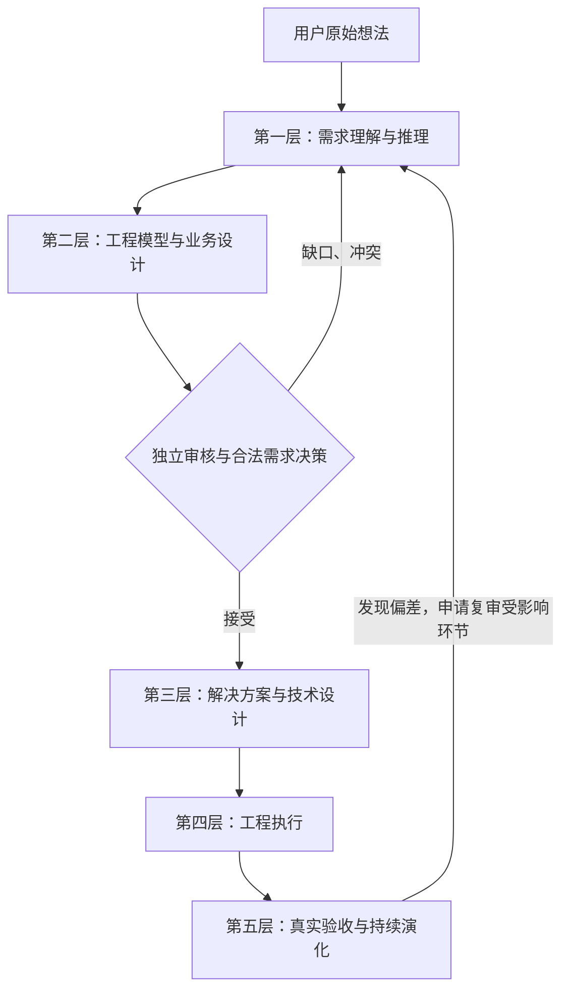
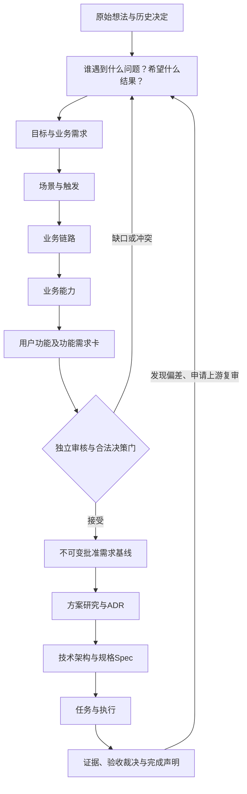

# 需求推理与需求工程 · 当前唯一入口（R3）

状态：候选研究；已核验既有正式流程并完成旧检查器定向反例运行。独立模型实验 BLOCKED，专家评分 NOT_SCORED，未批准正式升格。

## 一屏理解：需求推理只增强上游，不重造工程框架

用户不完整想法 → **理解与展开**（目标/问题/角色/场景/链路）→ **反推与发现**（必要条件/结果/验收）→ **质疑与补漏**（异常/依赖/冲突/风险/恢复）→ **裁剪与收敛**（去重/必要性/范围/剩余未知）→ 现有 AI-Project-OS 功能需求卡 → 独立审核与合法 Decision Gate → 不可变批准基线 → 既有设计/研发/测试/验收。以上四组是候选工作方式，不能替代正式工作流或九算子实验；未验证最小充分。

R3 实际进展：
- 固定读取 VizTell da80729ed0ac274bf3ba299f8872a0ae5811ac36、AI-Project-OS 1a1867640b7ee538bac21cd1a16d50f6a7e19c0f、OpenDesk main 4194fb7b2ea8f05633bc2a2e0ed0c5e4efac9cee；产品回顾案例仍取 91239889481bad3f42edb30e84e1012aa1901fc0。VizTell 迁移提交4a864d24之后已有 R1-B；不改父专题。
- 九算子功能重叠审计见 [01](01_语义对齐与资产去重.md) R3 增量，尚无真实消融结果。原始定义/编号均保留。
- [03_R3_盲测规格与冻结基准](03_R3_盲测规格与冻结基准.md)：61个原子判卷条目，53个必需分母（含33个关键安全项）；两真实回顾案例和一合成非浏览器案例；独立基准复核待完成；预注册36个A/B运行槽，非执行数。
- [04_R3_检查器反例与复跑](04_R3_检查器反例与复跑.md)：原函数实际14项符合预期，4份样例局部Schema校验无错误，新12个反例均漏过旧图检查，9个亦漏过局部Schema；标准库复跑待完成。
- [02](02_案例与评测接续.md) 为案例历史证据及唯一下一行动 R3.1：运行真正隔离的A/B、独立判卷；无环境则BLOCKED。无真实覆盖/成本/问答/模型结果；六维均NOT_SCORED。

提交前发现并行提交 0a16e30ea09af86f61b1597e41841ee5e15b301d 已完善五层阅读视图与R1-B/R1-C分工；本次以其为实际写入父提交，保留五层视图及接续边界。

以下保留既有R2.1框架与并行完善的五层研发阅读视图，不当作R3实证。


**一句话目标：** 人只提出一个不完整想法，AI 就能发现必须满足的目标、角色、场景、规则、异常与验收结果，避免需求遗漏、范围膨胀、目标漂移和虚假完成；不要求人先写完整规格。

## 一、最终要建立的 AI 原生研发框架（五层阅读视图）

**最终目标不是建立一套庞大的文档系统，而是让 AI 从用户的原始想法持续推理、设计、执行、验收与修正，直到真正解决用户问题。** 以下为方便人理解的功能分层，不是新的运行时架构、正式生命周期阶段或内核对象枚举。



| 层级 | 解决的问题 | 关键能力与输出 |
|---|---|---|
| 第一层：需求理解与推理 | 为什么做、为谁做、用户究竟需要什么？ | 目标推理、用户问题分析、利益相关者分析、使用场景推理、潜在需求发现、约束与异常推理；输出有来源的候选目标、需求、非目标、Unknown、风险及验收方向 |
| 第二层：工程模型与业务设计 | 如何把理解转化为可审查的业务设计？ | 目标树、需求树、场景模型、业务链路、能力树、功能树、业务规则、功能需求卡；经现有独立审核和合法 Decision Gate 形成批准需求基线 |
| 第三层：解决方案与技术设计 | 采用什么办法满足已澄清的需求？ | 竞品与技术研究、多方案比较、产品与交互设计、系统架构、数据模型、工程规格 Spec；方案取舍进入 Research/ADR，active Spec 只能消费合法批准的基线 |
| 第四层：工程执行 | 如何把批准设计转化为实际产品？ | 任务拆解 DAG、Workflow 编排、Skill 调用、Agent 协作、代码开发、测试与修复；以版本化 Spec、执行契约和独立授权为边界 |
| 第五层：真实验收与持续演化 | 用户问题是否真实解决，出现变化怎么办？ | 真实运行证据、独立验收裁决、需求覆盖检查、缺陷与遗漏发现、影响分析、增量知识沉淀；以事前判据、有效 Evidence 和 Verdict 为完成声明依据 |

五层不是严格单向瀑布：研究、设计、验证可以迭代；下游发现遗漏或错误只能请求对应上游 owner 复审，通过合法决策后更新版本与受影响闭包，不能自行修改批准目标或重做全部项目。简单项目按既有治理规则裁剪，不强制生成所有树、图、文档和评审；共享事实使用稳定引用与派生视图，避免重复权威。

### 研究专题分工

| 独立研究方向 | 负责的问题 | 当前专题如何使用 |
|---|---|---|
| 工程模型宇宙 | AI 需要理解哪些工程模型、语义和关系？ | 引用 [05 元模型候选](../05_最小工程语义元模型与关系注册候选.md) 与 [06 反例验证](../06_工程语义样例与反例验证.md)，不重复建模 |
| 需求推理 | AI 怎样主动发现、推导、审计和收敛需求？ | 本专题负责第一层与第二层上游推理；九种算子是待验证的核心候选 |
| 角色与利益相关者 | 谁的目标、责任、风险和利益可能遗漏？ | 为横向、场景、冲突推理提供视角；不在本专题另建角色宇宙 |
| 多专家协作 | 谁独立发现盲区、反例并审核？ | 提供独立审核与反方能力；同一 AI 模拟多个角色不等于独立专家 |
| 研发工作流 | 怎样从想法推进至真实交付？ | 复用[现有需求设计工作流](https://github.com/shopable-ai/ai-native-project-os/blob/1a1867640b7ee538bac21cd1a16d50f6a7e19c0f/docs/workflows/REQUIREMENT_DESIGN_WORKFLOW.md)及现行交付协议；不重造主流程 |
| AI-Project-OS 正式框架 | 哪些知识经过验证可以成为执行协议？ | 按现有治理、升格、版本与兼容门禁接入，候选研究不得直接驱动执行 |

VizTell 保存研究知识、方法和实验；AI-Project-OS 保存正式工程协议与执行能力；OpenDesk Browser 及其他业务项目保存业务权威、代码及真实证据。知识研究的读取方向不改变正式 L3→L2→L1 依赖契约。

### 与现有正式工作流的详细映射：只做上游推理，不重造全生命周期工作流



C–G 是本专题重点：递归拆解、横向角色与场景、反向结果、异常/依赖/冲突推理、范围收敛。A–I 是既有 AI-Project-OS [人机协作需求设计工作流](https://github.com/shopable-ai/ai-native-project-os/blob/1a1867640b7ee538bac21cd1a16d50f6a7e19c0f/docs/workflows/REQUIREMENT_DESIGN_WORKFLOW.md)的概念阅读视图，不是另立状态机；J–M 由下游现有执行框架负责。未批准的来源与候选不能驱动 active Spec 或外部执行。

| 关键问题 | 输入 → 输出 |
|---|---|
| 为什么做？ | 原话、现状、痛点 → 目标和非目标 |
| 为谁做？ | 角色、任务、权限、影响 → 角色视角和场景 |
| 用户如何实现目标？ | 场景/触发 → 业务状态链路 |
| 必须具备什么？ | 链路 → 业务能力 → 用户功能 → 功能需求卡 |
| 什么情况下失败？ | 正常链反向质询 → 异常、约束、Unknown、验收方向 |
| 哪些必须本轮做？ | 价值、必要性、硬依赖、风险 → 最小范围、延期与待决 |
| 如何证明？ | 事前判据 → 真实 Run/Evidence → 独立 Verdict；不能自行批准 |

### 用连播助手理解

原始意图“看剧自动跳片头片尾并进入正确下一集”→ 用户不想每集拖动 → 当前正片身份、播放时序、跳过和正确导航 → 识别媒体、规则编辑、跳过、连播能力及可见功能 → 功能需求卡固定真实时长、有效区间、播放/暂停/回看、倒序/分页、未知目标时停止 → 验收要求到达正确下一集并实际起播。

**实现方法不等于需求。** 原生“下一集”按钮、列表推断、用户指认是候选方案，不全选；完整作品识别服务归组和复用，不是基础跳过的必要前提。这个例子与既有正式产品需求相符，但尚无独立盲测证明 AI 会自动发现全部细节。

## 二、目前真正有价值的研究内容：九种需求推理机制

**要验证的是推理质量与最小充分性，而不是九个名称、生成文档的数量或输出字数。** 九种算子是可选择、可组合的候选工具；是否互相独立、是否可以合并、怎样按风险触发，交 R3.1 真实配对实验。通用对象、审批、证据、版本及生命周期已有权威，不重复定义。

| 算子 | 操作与反问 |
|---|---|
| DECOMPOSE 纵向推理 | 一个目标可拆成哪些必要子目标？去掉一项是否仍可达到目标？ |
| EXPAND 横向推理 | 不同用户、角色、对象、环境与状态是否有遗漏？ |
| JOURNEY 生命周期推理 | 进入、准备、执行、结果、保存/取消、离开、恢复怎样衔接？ |
| REVERSE 反向推理 | 从最终可观察的成功结果反推必要前提与回执 |
| OBSTACLE 异常推理 | 什么会令目标失败？错对象、竞态、撤权、重复、UNKNOWN 怎么处理？ |
| DEPENDENCY 依赖推理 | 哪些是真正前置条件？是否把可选增强误作前置？ |
| CONFLICT 冲突推理 | 目标/规则/角色利益/历史决定何时不兼容？谁负责裁决？ |
| DISCOVER 潜在需求发现 | 通过真实旅程、数据生命周期、风险与领域证据发现用户未主动提出但必须满足的义务 |
| PRUNE_VERIFY 收敛推理 | 去重、最小必要性、验收可观察性、证据与范围；拒绝无价值扩展和过度设计 |

这些是软件需求专项的推理应用，不是新通用思维本体。通用研究输入、预算、停止和回归遵循[跨宇宙多维推理与节点续研协议](../../思维与方法宇宙/03_跨宇宙多维推理与节点续研协议.md)；通用项目主链引用[项目与复杂任务链路](../../通用链路宇宙/15_项目与复杂任务链路宇宙.md)。

### 执行逻辑（候选设计，不是已执行算法）

```text
恢复原话、最新合法决定、实际读取版本、已知/未知、范围
建立目标/角色/问题候选，按风险和价值选待推理节点
对节点执行适用算子 → 生成有来源、理由、风险、验收方向的候选
语义归一并复用稳定身份 → 查重、必要性、依赖、冲突
只展开尚未达到叶子条件的核心节点
反方检查场景→需求→能力/功能→判据追踪；发现缺口局部返回
输出候选差量、停止原因、未处理前沿、待决定及下一动作
由既有 Decision Gate 审查；不因停止而自动批准
```

叶子停止：单义务、适用条件和责任、可观察结果、失败/恢复或不适用理由、必要性和验收方向齐备。R2 原试验预算为深度5/节点120/轮次6/连续2轮无实质新增；只是待校准的实验参数，不是正式阈值或充分性证明。超预算、来源不可用、用户阶段边界、阻断型未知均记录剩余前沿；不冒称完整。变化只重审影响闭包，不能通过删减批准需求分母提高完成率。

### 最重要的防漂移规则

1. 原话、AI候选解释、批准意图、实现意图分离；引用现有四段意图，不另发正式字段。
2. 目标树、能力树、功能树、场景视图、任务 DAG 都应通过稳定引用和合法关系生成；不要求每个项目生成全套树，也不为每个名词建立新内核对象。
3. 方案替代（OR/XOR）与必要条件（AND）只作为研究推理表达；关系注册、方向、合法端点引用 [R1-B §4.6 的 R2.1 增量接口](../05_最小工程语义元模型与关系注册候选.md#46-并行-r21-需求推理的增量接口交付时发现)，并服从现行 L1 allowlist。R1-B 已提供候选映射和8对/16项合成反例计算（见06），未正式升格；后续 R1-C 负责关系一致性、影响传播和证据适用性，R3 负责需求推理效果、最小必要性与范围。
4. 推断、批准、实现、证据和验收独立；高风险/权限/不可逆行为必须走现行合法批准。未知外部结果先对账，不盲重放。
5. 核心需求的来源、用户旅程、异常、验收方向必须可追踪；正式工作流还要求批准基线、Spec、Task、Evidence、Verdict，不能以实验图取代。

## 既有职责与阅读顺序（R3新实验入口见页首）

| 文件 | 作用 |
|---|---|
| 本 README | 人话框架、真正新增的需求专项推理方法 |
| [01_语义对齐与资产去重](01_语义对齐与资产去重.md) | 既有框架映射、冲突、原始R2迁移清单、证据归属 |
| [02_案例与评测接续](02_案例与评测接续.md) | 两案例反例、完整语义簇回查链接、评测待办、历史R3提示词及唯一R3.1任务 |
| snapshots/R2-original/ | 历史 JSON Schema、两组 fixture、轻量检查器；冻结原件，只作实验输入，非正式契约 |

现有工程模型宇宙 R1-A.2、R1-B 的历史入口和文件不改；R1-C 接续由父目录 90 维护；本专题是需求专项，不另定义工程元模型、角色宇宙或全生命周期工作流。角色研究在 R2.1 固定仓库树中未发现独立同名专题；后续以已核实的最新研究入口映射，不假设已经完成。
