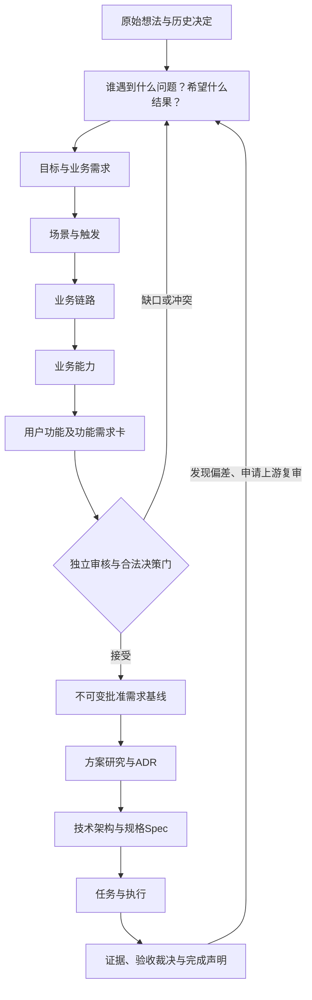

# 需求推理与需求工程 · 当前唯一入口（R2.1 归属纠偏）

任务：AI-NATIVE-REQUIREMENT-REASONING-R2.1。状态：候选研究、跨仓静态对齐；非正式执行协议、非已验证自动引擎。

**一句话目标：** 人只提出一个不完整想法，AI 就能发现必须满足的目标、角色、场景、规则、异常与验收结果，避免需求遗漏、范围膨胀、目标漂移和虚假完成；不要求人先写完整规格。

## 先看整体框架：只做上游推理，不重造全生命周期工作流



C–G 是本专题重点：递归拆解、横向角色与场景、反向结果、异常/依赖/冲突推理、范围收敛。A–I 是既有 AI-Project-OS [人机协作需求设计工作流](https://github.com/shopable-ai/ai-native-project-os/blob/1a1867640b7ee538bac21cd1a16d50f6a7e19c0f/docs/workflows/REQUIREMENT_DESIGN_WORKFLOW.md)的概念阅读视图，不是另立状态机；J–M 由下游现有执行框架负责。未批准的来源与候选不能驱动 active Spec 或外部执行。

| 关键问题 | 输入 → 输出 |
|---|---|
| 为什么做？ | 原话、现状、痛点 → 目标和非目标 |
| 为谁做？ | 角色、任务、权限、影响 → 角色视角和场景 |
| 用户如何实现目标？ | 场景/触发 → 业务状态链路 |
| 必须具备什么？ | 链路 → 业务能力 → 用户功能 → 功能需求卡 |
| 什么情况下失败？ | 正常链反向质询 → 异常、约束、Unknown、验收方向 |
| 哪些必须本轮做？ | 价值、必要性、硬依赖、风险 → 最小范围、延期与待决 |
| 如何证明？ | 事前判据 → 真实 Run/Evidence → 独立 Verdict；不能自行批准 |

### 用连播助手理解

原始意图“看剧自动跳片头片尾并进入正确下一集”→ 用户不想每集拖动 → 当前正片身份、播放时序、跳过和正确导航 → 识别媒体、规则编辑、跳过、连播能力及可见功能 → 功能需求卡固定真实时长、有效区间、播放/暂停/回看、倒序/分页、未知目标时停止 → 验收要求到达正确下一集并实际起播。

**实现方法不等于需求。** 原生“下一集”按钮、列表推断、用户指认是候选方案，不全选；完整作品识别服务归组和复用，不是基础跳过的必要前提。这个例子与既有正式产品需求相符，但尚无独立盲测证明 AI 会自动发现全部细节。

## 核心增量：九个需求推理算子

| 算子 | 操作与反问 |
|---|---|
| DECOMPOSE 分解 | 父目标需要哪些共同条件？去掉一项是否仍能达到目标？ |
| EXPAND 横向 | 对谁、哪种对象、哪个状态/环境？是否遗漏利益相关者？ |
| JOURNEY 生命周期 | 进入、准备、执行、结果、保存/取消、离开、恢复怎样衔接？ |
| REVERSE 反推 | 要观察到成功结果，必须具备哪些前提和回执？ |
| OBSTACLE 障碍 | 什么会令目标失败？错对象、竞态、撤权、重复、UNKNOWN 怎么处理？ |
| DEPENDENCY 依赖 | 真正硬前提是什么？是否把可选增强误作前置？ |
| CONFLICT 冲突 | 目标/规则/历史决定何时不兼容？谁负责裁决？ |
| DISCOVER 潜在需求 | 通过真实旅程、数据生命周期、风险与领域证据发现未说出的必要义务 |
| PRUNE_VERIFY 收敛 | 去重、最小必要性、验收可观察性、证据与范围；拒绝无价值扩展 |

这些是软件需求专项的推理应用，不是新通用思维本体。通用研究输入、预算、停止和回归遵循[跨宇宙多维推理与节点续研协议](../../思维与方法宇宙/03_跨宇宙多维推理与节点续研协议.md)；通用项目主链引用[项目与复杂任务链路](../../通用链路宇宙/15_项目与复杂任务链路宇宙.md)。

### 执行逻辑（候选设计，不是已执行算法）

```text
恢复原话、最新合法决定、实际读取版本、已知/未知、范围
建立目标/角色/问题候选，按风险和价值选待推理节点
对节点执行适用算子 → 生成有来源、理由、风险、验收方向的候选
语义归一并复用稳定身份 → 查重、必要性、依赖、冲突
只展开尚未达到叶子条件的核心节点
反方检查场景→需求→能力/功能→判据追踪；发现缺口局部返回
输出候选差量、停止原因、未处理前沿、待决定及下一动作
由既有 Decision Gate 审查；不因停止而自动批准
```

叶子停止：单义务、适用条件和责任、可观察结果、失败/恢复或不适用理由、必要性和验收方向齐备。R2 原试验预算为深度5/节点120/轮次6/连续2轮无实质新增；只是待校准的实验参数，不是正式阈值或充分性证明。超预算、来源不可用、用户阶段边界、阻断型未知均记录剩余前沿；不冒称完整。变化只重审影响闭包，不能通过删减批准需求分母提高完成率。

### 最重要的防漂移规则

1. 原话、AI候选解释、批准意图、实现意图分离；引用现有四段意图，不另发正式字段。
2. 目标树、能力树、功能树、场景视图、任务 DAG 都应通过稳定引用和合法关系生成；不要求每个项目生成全套树，也不为每个名词建立新内核对象。
3. 方案替代（OR/XOR）与必要条件（AND）只作为研究推理表达；关系注册、方向、合法端点等待工程模型 R1-B 并服从现行 L1 allowlist。
4. 推断、批准、实现、证据和验收独立；高风险/权限/不可逆行为必须走现行合法批准。未知外部结果先对账，不盲重放。
5. 核心需求的来源、用户旅程、异常、验收方向必须可追踪；正式工作流还要求批准基线、Spec、Task、Evidence、Verdict，不能以实验图取代。

## 唯一职责与阅读顺序

| 文件 | 作用 |
|---|---|
| 本 README | 人话框架、真正新增的需求专项推理方法 |
| [01_语义对齐与资产去重](01_语义对齐与资产去重.md) | 既有框架映射、冲突、原始R2迁移清单、证据归属 |
| [02_案例与评测接续](02_案例与评测接续.md) | 两案例反例、完整语义簇回查链接、评测待办、唯一R3提示词 |
| snapshots/R2-original/ | 历史 JSON Schema、两组 fixture、轻量检查器；冻结原件，只作实验输入，非正式契约 |

现有工程模型宇宙 R1-A.2、R1-B 的入口和文件不改；本专题是需求专项，不另定义工程元模型、角色宇宙或全生命周期工作流。角色研究在当前固定仓库树中未发现独立同名专题；未来以已核实的研究入口映射，不假设已经完成。
