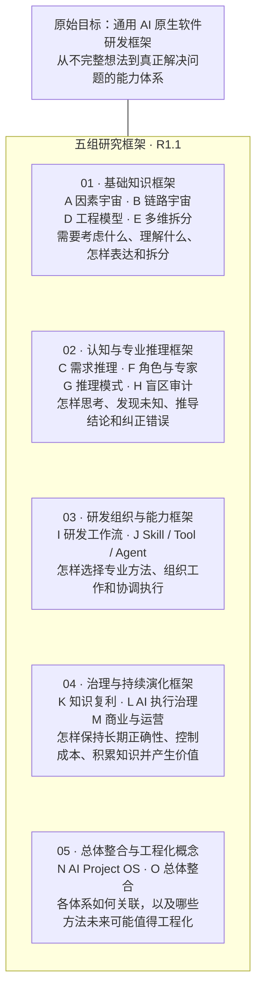

# AI 原生软件研发 · 总体框架导航 R1.1

**当前研究对象：框架本身。** R1.1已对A–O完成重点理论深化、专业知识导航和跨专题单模型反方自审；当前自评94.83/100，未通过最终验收。最新有效裁决：[O §11](../results/R3-O/FRAMEWORK.md)；[当前研究状态](../results/R3-O/13_RESEARCH_STATUS.md)。不进入具体应用和工程化。

## 总体框架总览

**原始目标：通用 AI 原生软件研发框架**

从不完整想法到真正解决问题的能力体系。

本图保存此前对话中展示的五组总体框架及其核心问题。五组是当前阅读与研究分类，不是五个必须顺序执行的研发阶段，也不是已经确定的系统模块。R1.2 横向收敛仍可修正分组；本次只补充可视化阅读入口，不改变研究结论、评分或阶段状态。

### 五组框架与专题正文

| 专题组 | 主要内容 | 入口 |
|---|---|---|
| 01 基础知识框架 | 因素宇宙、链路宇宙、工程模型、多维拆分 | [A](../results/R3-A/FRAMEWORK.md) · [B](../results/R3-B/FRAMEWORK.md) · [D](../results/R3-D/FRAMEWORK.md) · [E](../results/R3-E/FRAMEWORK.md) |
| 02 认知与专业推理框架 | 需求推理、角色与多专家、推理模式、盲区审计 | [C](../results/R3-C/FRAMEWORK.md) · [F](../results/R3-F/FRAMEWORK.md) · [G](../results/R3-G/FRAMEWORK.md) · [H](../results/R3-H/FRAMEWORK.md) |
| 03 研发组织与能力框架 | 工作流、Skill、Tool与Agent | [I](../results/R3-I/FRAMEWORK.md) · [J](../results/R3-J/FRAMEWORK.md) |
| 04 治理与持续演化框架 | 知识复利、AI执行治理、商业与运营 | [K](../results/R3-K/FRAMEWORK.md) · [L](../results/R3-L/FRAMEWORK.md) · [M](../results/R3-M/FRAMEWORK.md) |
| 05 总体整合与工程化概念 | AI Project OS概念职责、总体整合及边界 | [N](../results/R3-N/FRAMEWORK.md) · [O](../results/R3-O/FRAMEWORK.md) |

**研究顺序：先横向建立整体框架，再纵向深入有价值的分支，最后整合与审查。** 当前阶段禁止提前执行具体应用。详见[研究阶段与推进原则](RESEARCH-STAGES.md)。

## 当前唯一下一任务（R1.2 候选，尚未执行）

**任务：AI-NATIVE-DEV-FRAMEWORK-R1.2-MAP-CONVERGENCE｜总图收敛与单点纵向深化。**

当前已知（核对main `86ea0696e75e57ef07db29ab4bd7dbd9a8725a66`）：A–O 15/15 FRAMEWORK正文齐备，R1.1多轮理论深化和总体整合已有实际文档成果；Q2知识与证据94、Q5可读93、Q6一致性94、综合94.83仍未达到95。下次不从F1重新建立15个框架，不重复前序理论查证或历史案例。仓库不能证明其他对话是否仍运行；新会话先核对最新main、已有差量和文件归属。

- **先收敛横向地图**：对照[既有11个一级研究方向](../../../docs/软件与系统工程宇宙/00_AI原生研发总体框架与关键结论.md#knowledge-universe-map)、本页五组/七视图及O的15专题职责。先给一屏可读、一级粗体+分号分隔二级条目的无序列表；三级只用缩进。辨析对象、分类、研究方法、执行能力与系统构想。特别审查O §11.1–11.2的专业知识是否应独立成为一级领域（与知识资产生命周期管理区分），并处理商业运营、问题/需求、链路/工作流、因素/角色/模型/审计间关系。保留、合并、拆分或新增必须有独立职责和理由；不预设11/12等数量。总图是阅读入口，不把15任务、五阶段、七视角、18知识域或系统组件机械相加。
- **横向合理后只做一个纵向样本**：推理与决策 → 目标逆推 → 必要条件发现。基于G/C/B/D/H及O §11当前裁决，形成目标、定义及分类、关键问题、推理思路（公开可核验的判断步骤及理由）、所需知识、必要/充分条件、可实现性、典型抽象反例、结论、输出与停止边界。核对能改变结论的原始通用理论，区别证明/候选假设/证据范围。只用抽象问题，不进入具体项目。若横向重大结构冲突未处理，先留下明确阻断，不同时扩写其他节点。
- **整合及后续**：从样本提炼可迁移的研究内容组织方式，说明哪些栏目真正有用；只在新发现要求时局部回写总图或责任专题。按既有Q1–Q6审查，目标各项及综合≥95；独立审查不可得则保留自评及未验证，不以作者重新打分代替。未取得正式结构结论或有重大矛盾时不得宣布整体完成。

授权阅读例外仅限上述已存在的VizTell总体地图与其必要研究入口；其他研究遵守本目录FRAMEWORK边界。不访问OpenDesk/AI-Project-OS实际项目资料，不启动实际应用/实验/编码/自动化或旧待办。写入优先 O 现有 FRAMEWORK.md、00_NAVIGATION.md、13_RESEARCH_STATUS.md（及必要FRAMEWORK-STATUS/来源追溯），本页更新紧凑导航；如有总图变化可同步既有docs/00总体入口；需要修改某一专题时只改被确认的缺口并保留并行成果。原prompt/reference/launch与历史应用资料不重写，不新增平行目录。完成时报告实际增量、剩余未知、证据边界及Git回读。此任务安排本身不是R1.2已执行或已验收的证明；当前评分仍以O最新真实记录为准。

## 1. 原始目标与框架主线

建立一套通用的 AI 原生软件研发框架，使 AI 能从用户不完整的原始想法、功能变更或缺陷反馈出发，理解目标、发现必要需求和遗漏、设计合理方案、组织研发、测试、修复、真实验收与持续演化。当前交付对象是框架知识、分类、模型、推理方法、关系和选择规则本身，而不是某个软件产品。

未来软件研发的主线（源自R2五阶段视图）：

原始想法 / 需求变更 / 缺陷反馈 → 需求理解与推理 → 工程模型与业务设计 → 解决方案与技术设计 → 工程执行 → 真实验收与持续演化。

此主线描述未来软件研发，不是当前研究任务必须执行的五阶段。入口需要恢复已有目标、事实、成果及边界；具体任务允许复用和裁剪。研究、决策、审计、知识复用可以贯穿各阶段。

### 当前阅读入口
- [完整专题导航](../results/R3-O/00_NAVIGATION.md)
- [总体整合正文](../results/R3-O/FRAMEWORK.md)
- 最新研究状态、专业知识导航、反方与Q1–Q6：见[总体整合正文 §11](../results/R3-O/FRAMEWORK.md)；[当前研究状态（含历史）](../results/R3-O/13_RESEARCH_STATUS.md) · [来源追溯](../results/R3-O/14_SOURCE_TRACE.md)
- [延期应用索引](DEFERRED-APPLICATIONS.md)

## 2. 主要研究视图

| 视图 | 解决什么问题 | 主要专题 |
|---|---|---|
| 研究对象与因素 | 应考虑哪些对象、主体、属性、环境、条件及约束？ | A、F、M |
| 工程知识表达与拆分 | 如何表达对象及关系，划分知识和工作单元？ | D、E、K |
| 推导与行为关系 | 怎样由目标及已知条件得到其他知识或结果？ | B、C |
| 专业分析与判断 | 如何思考、选择视角、查漏、质疑与裁决？ | G、F、H |
| 工作组织与执行能力 | 怎样组合所需活动、方法、工具与执行者？ | I、J、E |
| 质量、治理及持续演化 | 怎样控制错误、风险、证据、资源和知识失效？ | H、K、L、M |
| 候选系统实现 | 哪些已经验证的知识将来可能需要软件支持？ | N，仅概念边界 |

这是按问题建立的阅读视图，不是新研发阶段或互斥实体。同一专题可以出现在多视图中。原有五阶段、五层职责、四层能力、九类职责及七/十环节视图都保留为不同用途的候选，不要求强制统一成一条线。

## 3. 专题导航与独立职责

| 任务 | R2来源 | 独立框架深化 |
|---|---|---|
| R3-A 因素宇宙 | 02 | 12领域、16维度与六类候选视图；因素、对象、属性、条件、取值、约束、质量、证据状态的区别，分层、关联、组合与选择。 |
| R3-B 链路宇宙 | 03 | 15专项链、总链及详细推导链；节点、边类型、输入输出、条件、共享节点、分支/循环/反馈/回退。区分推导、业务行为、执行与证据。 |
| R3-C 需求推理 | 04 | 八节点需求链、四组机制；意图、目标、问题、场景、能力、功能、规则、需求与验收的定义、必要性、异常、冲突、裁剪、收敛。 |
| R3-D 工程模型 | 05 | 17常用条目；模型、对象、视图、表示；模型家族的职责、最小语义、独立价值、适用性、关联与选择。35/14历史清单缺失须如实标明。 |
| R3-E 项目多维拆分 | 05 | 目标、业务、产品、技术、交付、垂直专业方法和横向复用等拆分轴；独立边界、粒度、依赖、交叉关系及可验收性。 |
| R3-F 角色与多专家 | 06 | 七类利益相关者、九类专业知识、责任权限、实际参与者；动态利益、专家选择、独立判断、分歧与裁决。 |
| R3-G 推理模式 | 07 | 13模式及演绎、归纳、溯因；区分逻辑、方向、探索策略、证据与评价；方法语义、条件、组合、停止与反例。 |
| R3-H 盲区审计 | 08 | 八审计领域、审计对象及缺陷性质、双向推演；15成熟方法线索按用途研究，风险优先、结果处置、回流和审计边界。 |
| R3-I 研发工作流 | 09 | 五阶段、七环节、十环节视图的关系；抽象任务路由、模型/方法/角色/能力编排、条件、裁剪、复用、并行及回退。 |
| R3-J Skill、工具与Agent | 10 | 13候选专业能力的分类、边界、选择、接口、权限、失败处理；能力、工作方法、工具、执行者及工作流的区别；不实现Skill。 |
| R3-K 知识资产与知识复利 | 11 | 来源、想法、假设、事实、证据、决策、资产、方法和经验的分类与状态；索引、恢复、失效、回归知识和复用。 |
| R3-L AI执行治理 | 11 | 上下文、状态、权限、模型及工具选择、成本、并发、重复、失败、人工干预与质量的控制原则、观测指标定义。 |
| R3-M 商业与运营框架 | 11 | 用户/购买者/受益者、价值、市场因素、商业假设与反馈、运营及企业经营边界；仅研究通用框架。 |
| R3-N AI Project OS概念框架 | 12 | 七个候选组件的职责、关系、替代性、必要性假设与系统边界；暂不判断真实项目实施收益，不建设系统。 |
| R3-O 总体框架整合 | 01/13/14 | 整合总体地图、处理分类重叠和跨专题接口，审查覆盖、逻辑、理论依据、可阅读性、必要性，分离未决框架问题和后续实证待办。 |

截至R1.1，15专题正文及各专题状态已增量更新。F1入口齐备，F2/F3核心问题第三轮深化及收敛；尚未达到最终验收目标。各FRAMEWORK-STATUS.md当前区块及O §11为最新入口，旧区块保留为历史。

## 4. 原始16个研究维度的归属候选

| 原始维度 | 主要职责 |
|---|---|
| 角色 | F（主体、专业知识、责任与实际参与者） |
| 推理模式 | G（通用思考方法） |
| 场景 | A（因素）、D（表达）、C（需求发现） |
| 需求 | C（推导）、D（模型） |
| 约束 | A（分类）、G（判断）、C/D（表达） |
| 质量 | H（评价和审计）、D（质量模型） |
| 证据 | H（核查）、K（知识状态及保存）、D（证据表达） |
| 决策 | B（过程）、G（判断）、F（权限裁决）、K（记录） |
| 工作流 | I（编排） |
| Skill | J（专业能力） |
| 工具 | J（调用及操作能力）、L（权限/资源治理） |
| 风险 | A（影响因素）、H（审计） |
| 资产 | K（类别与生命周期） |
| 商业 | M（价值与运营） |
| 生命周期 | B（过程）、K（资产）、M（运营） |
| AI治理 | L（执行边界） |

部分维度跨专题，应该按职责区分而非为追求唯一归属复制定义。16研究维度不是12因素领域的直接子目录。

## 5. 第一轮跨专题概念审查（本轮推断）

| 容易混淆的接口 | 建议共同定义及裁决 | 后续需完善 |
|---|---|---|
| A因素 / D模型 / H审计 | 因素提供关注对象和可变条件；模型表达特定对象及关系；审计在目标和风险下检查遗漏、错误和缺证。一个名词可关联三者，但不必复制完整分类。 | A提供索引，D表达选用的知识，H引用因素和模型；进一步厘清风险/质量/证据。 |
| B链路 / I工作流 / G推理 | 链路描述节点和边的语义，工作流选择并编排活动，推理操作知识和主张。逻辑推导箭头不等于时间先后，更不等于已完成执行。 | I必须支持分支、回退、复用和并行；G可跨链使用。 |
| B/D推导 / C需求 | 目标、场景、能力、功能、需求不是唯一线性顺序。需求和约束可能在功能出现前已知；功能可能由多个需求支持，质量要求可能跨功能。目标反推得到候选必要条件，不自动成立。 | C/D共同确定定义、必要性与多对多关系；B提供推导及约束边。 |
| D模型 / E拆分 | 对象和模型不同，树图是表达；目标树、功能树、技术树、任务图可能相互引用，不能强行同步层级。 | E维护拆分规则和工作单元，D维护表达语义。 |
| F角色 / J Agent / G方法 | 角色是视角、责任或专业身份；实际参与者承担角色；方法是思考或专业操作；Agent是实际执行者；工具完成具体操作。多角色扮演不等于独立分析。 | J/L要明确调用、权限及实际运行身份，F定义责任、独立性和裁决。 |
| K事实 / F裁决 / H证据 | 事实是实际成立的事态；关于事实的主张可被证据支持或反驳；需求、方案、优先级和风险接受是决策对象。批准不能将假设变成事实。 | 原“已批准事实/业务需求”拆为证据支持的事实和已决策的需求，C/H/K协调定义。 |
| A/C约束 / G/M价值 / L治理 | 约束定义可行范围，价值评价在可行范围内进行，治理控制授权、成本与执行；高平均评分不能抵消硬性约束。 | M不重建A因素，L不重建G决策理论。 |
| J Skill / I Workflow / N系统 | Skill是局部可复用能力，Workflow组织活动，候选系统可提供运行支持。一个知识目录或引擎名称不等于必须实现一个模块。 | N只保留概念职责及价值假设；后续实证阶段决定是否工程化。 |
| H审计 / K知识 / B回退 | 审计指出应处置的问题，链路表达回流，知识系统记录证据和可复用经验。发现新证据只应使受影响的结论失效，不要求全量重做。 | 建立失效、纠错、复用的共同语义。 |

这些是框架级结构与概念反例研究，并非具体产品测试或已证实的实际使用收益。

## 6. 完善顺序与待解决问题

F1：把A–N完整一级框架和必要二级入口建立起来；O随时修正总体地图。F2：重点深化因素的语义类型、模型/需求/能力的区别、链路边关系、方法选择、工作流裁剪、证据/决策及知识失效等高影响分支；查阅通用专业理论、处理逻辑反例和重复，逐项判断去留。F3：综合Q1–Q6进行总体审查，处置重要冲突和框架未知，将产品实证待办单独保留。

当前审查结论：R1.1自评Q1–Q6为98/94/95/95/93/94，等权94.83/100（历史R1 94.50、F3 92.33）；非独立专家评审。Q2、Q5、Q6及综合未达95，阶段未完成验收。真实独立反方、理论深入复核及非作者可读性仍待；详见O §11.5–11.6。具体产品、测试、代码及系统实施继续延期，不作为框架阶段完成门。

## 7. R1.1 阅读与研究使用原则

先从上方五组确定问题所属专题，再看对应正文末尾的“R1.1 裁决”；需要专业知识导航、总体关系或验收时直接读O §11。保留原始R2资料及历史正文用于回溯，不要求从头读完或重复整理。五组是本轮提出的阅读分组，不改变A–O标识、七查询视图及原5/7/10活动视图。

**最短阅读路径：** 先看本页五组导航→总体问题读O §11.1、11.3；专业知识读§11.2；状态读§11.6；然后只读相关专题当前裁决及所需旧定义，不重读全库。保留已有结构，未增宏观框架。
