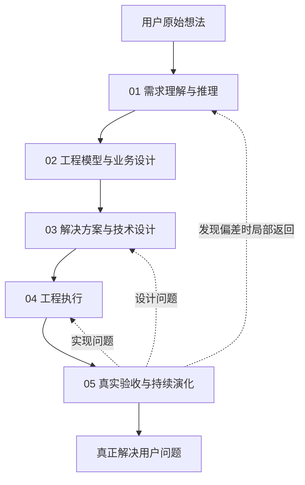
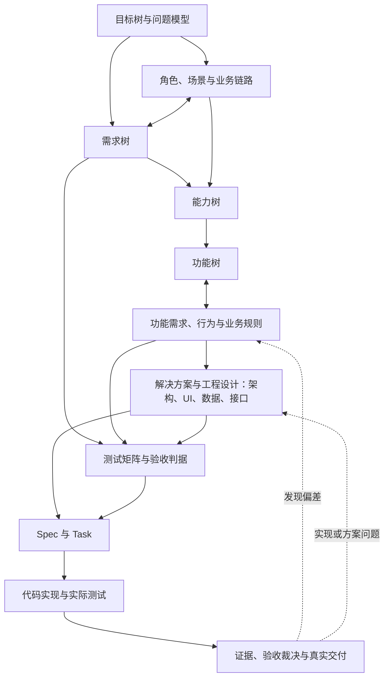
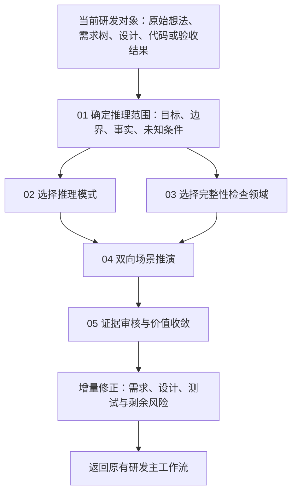
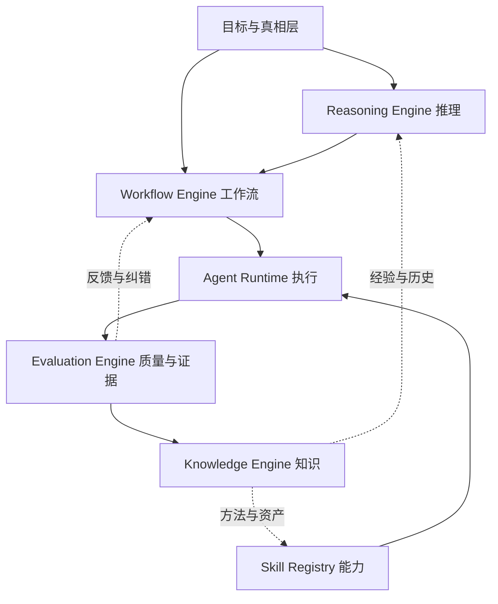
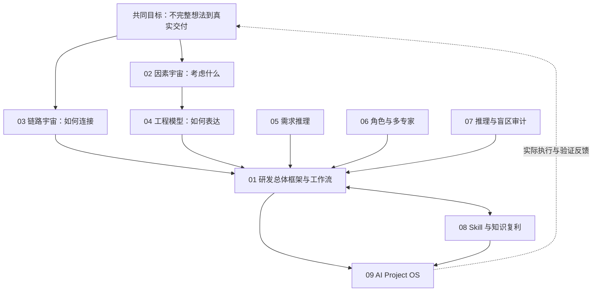

# AI 原生研发方法论 · 精选研究内容整理与优化版

> **AI-Native Development Methodology**  
> 版本：R1 · 2026-11-27  
> 来源：用户从多个对话中筛选的《粘贴的文本 (1)(4).txt》（848 行）。  
> 用途：将零散但有价值的研究内容整理为可直接阅读、继续推理、独立深化的知识材料。
>
> **阅读说明：** 本文以原始材料为依据，保留主要框架、表格、研究线索与术语，合并重复表达；新增分类、关联关系与研究方向标为「整理推导」。本文是候选研究框架，不是已验证的正式工程规范，也不是要求立即执行所有研究的任务清单。

## 目录

1. [原始目标与总体框架](#1-原始目标与总体框架)
2. [研究宇宙与因素地图](#2-研究宇宙与因素地图)
3. [链路宇宙](#3-链路宇宙)
4. [研发工作流与项目拆分](#4-研发工作流与项目拆分)
5. [工程模型体系](#5-工程模型体系)
6. [需求推理体系](#6-需求推理体系)
7. [推理模式与全链路盲区审计](#7-推理模式与全链路盲区审计)
8. [利益相关者、专业能力与多专家协作](#8-利益相关者专业能力与多专家协作)
9. [Skill、执行能力与知识复利](#9-skill执行能力与知识复利)
10. [AI Project OS 系统构想](#10-ai-project-os-系统构想)
11. [材料性质与后续研究方向](#11-材料性质与后续研究方向)
12. [原文追溯与整理边界](#12-原文追溯与整理边界)

---

## 1. 原始目标与总体框架

### 1.1 原始目标

建立一套 AI 原生软件研发方法，使用户不需要提前整理完整的需求，仅提出一个初始想法、问题或期望结果，AI 就能够逐步理解目标、发现需求、分析业务场景、设计产品、比较方案、拆分任务、执行研发、测试与修复，并通过真实验收判断是否解决了用户问题。

整个研究不仅是让 AI 编写代码，更重要的是让 AI 能够理解完整的软件工程知识，主动发现遗漏、选择必要的方法和专业能力，并持续积累可以跨项目复用的经验。

发现问题后，应返回相应环节进行局部修正，而不是默认重新执行整个项目。

### 1.2 总体认知：三类研究对象

以下三类是对原文整体结构的**整理推导**，不是三个必须依次完成的研发阶段。

| 层次 | 核心问题 | 主要内容 |
| --- | --- | --- |
| 软件研发认知体系 | AI 需要理解什么、考虑什么？ | 工程模型、角色、利益关系、需求、场景、约束、质量、风险、证据、商业等 |
| AI 研发方法与推进体系 | AI 怎样分析、推理、决策、组织和验证？ | 需求推理、推理模式、研发工作流、多维拆分、多专家协作、全链路盲区审计、知识复用 |
| AI 原生研发执行系统 | 怎样把已经有价值的方法转化为可执行能力？ | 目标与真相层、Reasoning Engine、Workflow Engine、Skill Registry、Agent Runtime、Evaluation Engine、Knowledge Engine |

三者应相互配合：认知体系帮助发现要考虑的对象；方法论组织分析和执行；系统实现承载经过选择与验证的能力。不能因为有了系统名称就认为方法已经有效，也不能将研究目录直接等同于系统模块。

### 1.3 最值得保留的五阶段研发主线



| 阶段 | 原文关键内容 | 主要结果 |
| --- | --- | --- |
| 01 需求理解与推理 | 目标、问题、角色、场景、潜在需求、需求树 | 对目标、问题和必要需求的理解 |
| 02 工程模型与业务设计 | 业务链路、能力树、功能树、业务规则、用户旅程 | 产品应具备的能力、行为、规则与边界 |
| 03 解决方案与技术设计 | 资料研究、竞品分析、多方案比较、MVP、UI、系统架构、数据模型 | 可实施的方案与工程设计 |
| 04 工程执行 | 项目拆分、输入输出契约、任务树、Workflow、Skill、Agent、代码开发 | 任务、代码、构建产物与定向验证 |
| 05 真实验收与持续演化 | 测试矩阵、真实运行、问题修复、错题库、知识沉淀、持续迭代 | 真实验收结果、问题修复及复用经验 |

**贯穿所有阶段的基础能力：** 上下文恢复、事实与证据、关系追溯、输入输出契约、知识复用、防止目标漂移、决策记录、错题归纳、上下文交接和 Skill 优化。

### 1.4 原文中的其他分层如何理解

原文还包含两种具有独立阅读价值的分层方式。它们与五阶段主线可以相互映射，但不应重复建设为多套生命周期。

| 研发能力分类（原文开头） | 主要能力 |
| --- | --- |
| 需求层 | 目标提取、需求发现、需求树生成、盲区审计 |
| 研究层 | 竞品研究、开源检索、商业分析、可行性研究 |
| 设计层 | 产品设计、UI/UX 设计、系统架构、接口契约 |
| 执行层 | 任务拆解、Agent 调度、代码实现、构建部署 |
| 验收层 | 测试生成、代码审查、反方审计、真实验收 |

| 四层总体结构（原文另一版） | 主要内容 |
| --- | --- |
| 认知与推理层 | 目标理解、需求推理、领域知识、多专家协作 |
| 工程模型与设计层 | 需求与功能、角色与场景、业务与交互、架构与数据模型 |
| 研发执行层 | Task、Workflow、Skill、Agent |
| 验证与演化层 | 测试与修复、真实验收、错题与知识库、持续迭代 |

**整理推导：** 五阶段适合说明研发推进；四层适合概览认知、设计、执行和演化；研发能力分类适合查找可调用的方法。研究可以在需求、设计、开发和故障定位中按未知问题触发，不必局限在一个固定阶段。

## 2. 研究宇宙与因素地图

### 2.1 原文的 16 个研究宇宙

保留原文完整目录与当时的研究优先级，便于后续逐项深化。P0/P1 为原材料中的建议，不是本轮重新确认的执行排程。

| 研究维度 | 要解决的问题 | 研究优先级 |
| --- | --- | --- |
| 角色宇宙 | 谁参与、谁受益、谁反对、谁验收？ | P0 |
| 推理模式宇宙 | AI 应该采用哪种思考方式？ | P0 |
| 场景宇宙 | 用户在什么情况下使用，会发生哪些异常？ | P0 |
| 需求宇宙 | 如何发现显性、隐性、潜在及冲突需求？ | P0 |
| 约束宇宙 | 时间、资金、技术、权限、资源如何限制方案？ | P0 |
| 质量宇宙 | 如何衡量正确性、安全性、体验、性能？ | P0 |
| 证据宇宙 | 如何区分事实、假设、推断和真实验证？ | P0 |
| 决策宇宙 | 如何选择、否决、撤销、重新评估方案？ | P0 |
| 工作流宇宙 | 不同任务应该选择怎样的执行流程？ | P0 |
| Skill 宇宙 | 哪些专业能力可以独立复用？ | P1 |
| 工具宇宙 | 如何选择模型、MCP、API、浏览器及本地工具？ | P1 |
| 风险宇宙 | 系统会怎样失败？如何恢复和回滚？ | P0 |
| 资产宇宙 | 文档、代码、模板、测试、知识如何长期复用？ | P1 |
| 商业宇宙 | 产品价值、定价、增长、市场和竞争如何验证？ | P1 |
| 生命周期宇宙 | 发布之后如何运营、维护、升级、退役？ | P1 |
| AI 治理宇宙 | 如何控制成本、权限、上下文、执行状态？ | P0 |

### 2.2 重新归类：这些宇宙不是同一种研究对象

| 研究类别（整理推导） | 包含原文研究对象 | 核心用途 |
| --- | --- | --- |
| 业务与价值 | 角色、场景、需求、商业 | 发现为谁解决什么问题，在什么条件下产生价值 |
| 约束、风险与质量 | 约束、风险、质量、证据 | 理解边界，判断可行性、正确性和风险 |
| 分析与决策 | 推理模式、决策 | 选择分析方式、比较方案与处理冲突 |
| 执行与能力 | 工作流、Skill、工具 | 组织任务，选择局部能力及实际执行手段 |
| 资产与持续治理 | 资产、生命周期、AI 治理 | 维护知识、控制成本、组织长期变化 |

原文还明确提出工程模型宇宙、专业能力宇宙和利益关系分析，不能因为它们没有单独出现在上述 16 项表中而遗漏。

**因素宇宙的候选边界：** 角色、目标、场景、时间、资源、状态、数据、权限等可以成为具体研发问题中的考虑因素；需求、风险、质量、证据分别表达义务、可能失败、评价属性及证明材料。推理模式是方法，工作流是过程，Skill 是能力，工程模型是表达结构。它们都属于研发研究地图，但不宜未经论证就都定义为同一语义的「因素」。

后续应先研究各宇宙的对象、作用、交叉关系与独立价值，再决定是否分别建立完整目录。原文的 16 项是重要研究种子，而非已证实穷尽的因素分类。

### 2.3 历史研究方向（原文两份重复表合并）

| 历史研究方向 | 曾经涉及的内容 |
| --- | --- |
| 角色宇宙 | 用户、客户、开发者、运营、审核、风控、竞争者、投资人、合作方、关键决策人 |
| 利益关系分析 | 助力方、阻力方、利益受损方、资源提供方 |
| 推理治理系统 | Reasoning OS、推理模式库、专家自动选择 |
| 多维拆分 | 目标拆分、水平业务架构、垂直 AI 工作链、跨项目可复用能力 |
| 场景双向推演 | 正向推理、逆向验证、异常场景、责任空白 |
| 质量治理 | 反方攻击、盲区审计、过度设计、自我否决 |
| 资产生命周期 | 想法、候选、验证、采用、实施、测量、优化、退役 |
| 执行成本治理 | 上下文成本、模型选择、重复执行、人工干预 |
| 知识复利 | 错题库、回归测试、经验提取、Skill 化 |
| 公司与商业体系 | 产品研发、商业化、增长、运营、组织、财务、法务、资本 |

**边界判断（整理推导）：** 公司与商业体系涉及产品研发以外的商业化、增长、运营、组织、财务、法务和资本，应保留为关联研究方向。它会影响产品研发目标、约束及优先级，但不应全部强制纳入每次软件研发工作流。

## 3. 链路宇宙

原文既包含目标到需求的推导，也包含业务运行、研发推进、任务执行、验收和持续演化。以下 12 条链路为**整理推导**，目的是保留不同性质的过程，不是创建 12 套平行研发流程。

| 链路 | 典型过程或对象 | 解决的问题 |
| --- | --- | --- |
| 目标分解链路 | 总目标 → 子目标 → 必要条件 | 怎样把复杂目标拆成可理解、可实现的部分 |
| 需求推理链路 | 原始想法 → 目标与场景 → 需求发现与收敛 | 怎样发现必须满足的要求 |
| 用户旅程链路 | 用户问题 → 操作过程 → 期望结果 | 用户怎样完成完整任务 |
| 业务运行链路 | 业务触发 → 规则判断 → 业务行为 → 结果 | 产品自身怎样工作 |
| 工程模型推导链路 | 目标、需求、场景、能力、功能 → 工程设计 | 各类工程知识怎样提供依据与约束 |
| 研发工作流链路 | 需求 → 研究与设计 → 实施 → 验收 | AI 怎样组织完整研发过程 |
| 任务依赖链路 | Spec → Task → 依赖安排 → 实际执行 | 哪些任务可以并行，哪些存在前置条件 |
| 测试验收链路 | 需求与行为 → 判据 → 测试执行 → 证据 → 验收 | 怎样证明产品真正满足用户要求 |
| 问题修复链路 | 失败现象 → 原因假设 → 定位 → 修复 → 回归 | 怎样从失败返回真正受影响的环节 |
| 产品生命周期链路 | 研发 → 发布 → 运营 → 维护与升级 → 退役 | 软件怎样长期运行和演化 |
| 知识资产生命周期链路 | 想法 → 候选 → 验证 → 采用 → 实施 → 测量 → 优化或退役 | 候选知识怎样发展成有效资产 |
| 知识复利链路 | 错误 → 经验 → 回归测试 → 可复用方法或 Skill | 怎样避免跨任务重复犯错 |

### 3.1 重要的链路区别

- **用户旅程、业务运行链路**描述软件在实际使用中怎样运行。
- **需求推理、工程模型推导链路**描述 AI 怎样理解和推导应该研发什么。
- **研发工作流、任务依赖链路**描述 AI 怎样组织研发、分配工作和执行。
- **测试验收、问题修复链路**描述怎样判断正确性、怎样纠错。
- **产品、知识资产生命周期及知识复利链路**描述交付后和跨项目的长期演化。

链路之间可以相互提供输入，或由失败触发返回；它们不都是同一时间轴上的串行步骤。目标和需求也不能自动推出唯一技术实现，需要补充事实、规则及方案决策。

### 3.2 原文的资料到执行链路（语义整理版）

```text
原始资料 Source
  ↓
候选事实 / 已核验事实 / 假设 / 未知项
  ↓
业务目标与候选需求
  ↓
角色、场景与业务链路
  ↓
能力 Capability ↔ 功能 Function ↔ 行为与业务规则
  ↓
功能需求草稿 → AI 自检 → 适用审核与批准 → 需求基线
  ↓
专业研究 / 架构决策 / 工程设计
  ↓
Spec 与 Task → 实际执行与测试 → Evidence → Verdict
```

Workflow 组织以上推进及反馈；Task 由适当的 Agent 承担，按需调用 Skill 和 Tool。这里将原文「已批准事实」区分为事实核验与需求批准，并避免把「Spec → Task → Workflow → Skill/Tool」误读为固定时序。以上是本轮语义整理，不是对正式框架契约的修改。

## 4. 研发工作流与项目拆分

### 4.1 七环节简明工作流

| 研发环节 | 主要输入 | 主要输出 |
| --- | --- | --- |
| 目标理解 | 用户原始想法 | 目标、问题、范围 |
| 需求推理 | 目标、领域知识 | 需求、场景、约束 |
| 产品设计 | 需求与场景 | 功能、规则、交互设计 |
| 技术设计 | 产品设计 | 架构、数据、接口、技术方案 |
| 工程实施 | 已批准设计 | 任务、代码、构建产物 |
| 测试验收 | 需求、判据、实现 | 测试结果、验收证据 |
| 持续迭代 | 用户反馈、运行结果 | 缺陷、变更、知识沉淀 |

每个环节都可以关联适当的工程模型、专家角色、推理方式、Skill 和验证机制。工作流组织这些能力，而不是与它们重复建设。

### 4.2 十环节研发工作流综合关系矩阵（保留原文完整表格）

原文将五阶段细化为十个环节，并称与既有 R0、S0–S7 对齐。本轮保留这项研究线索，不另行核验正式框架的具体映射。

| 研发环节 | 解决什么问题 | 输入 | 工程模型 | 专业角色 | Skill | 输出 | 验收条件 |
| --- | --- | --- | --- | --- | --- | --- | --- |
| 00. 项目恢复 | 已经完成什么？ | 现有项目、代码、文档 | 项目结构、架构、问题模型 | 产品、开发 | 现状分析 | 当前基线、差量范围 | 已有成果与真实入口明确 |
| 01. 目标理解 | 为什么做？ | 用户原始想法 | 目标树、问题模型、角色模型 | 产品、领域专家 | 意图理解、需求推理 | 目标、范围、非目标 | 与原始意图一致 |
| 02. 专业研究 | 哪些问题还不知道？ | 未知项、约束 | 领域模型、风险模型 | 研究、领域、技术专家 | 证据研究 | 事实、实验、候选结论 | 关键判断有依据 |
| 03. 业务与需求设计 | 产品需要什么能力？ | 目标、场景、事实 | 需求树、场景树、业务链路、能力树、功能树 | 产品、业务、UX | 需求推理、业务建模 | 功能需求卡、业务规则 | 必要需求、异常和边界明确 |
| 04. 需求收敛 | 怎样才算业务正确？ | 候选需求、冲突 | 行为模型、需求基线 | 产品、测试、审核者 | 需求审计 | 批准需求、行为案例 | 通过适用决策门 |
| 05. 解决方案 | 采用什么方案？ | 批准需求、技术约束 | 架构图、决策模型 | 架构、技术专家 | 方案分析、可行性验证 | 选定方案、必要的 ADR | 可行性和取舍明确 |
| 06. 工程设计 | 具体怎样实现与验证？ | 行为规格、方案 | UI树、状态模型、数据模型、接口、测试矩阵 | UI、架构、开发、测试 | 工程设计、测试设计 | 工程契约、验收判据 | 输入输出、异常、验证范围明确 |
| 07. 工程执行 | 怎样真正做出来？ | 批准需求、设计、判据 | 任务依赖图、实现模型 | 开发、测试 | 任务拆分、编码、调试 | Spec、Task、代码、构建 | 任务与需求对应，定向检查完成 |
| 08. 真实验收 | 产品是否真的解决问题？ | 实现、候选包、测试判据 | 测试矩阵、证据关系图 | 测试、独立审核者 | 实际测试、证据核查 | Run、Evidence、Verdict | 实际结果满足事前判据 |
| 09. 持续演化 | 怎样持续改善？ | 运行结果、用户反馈 | 问题模型、运行模型、演化模型 | 运营、产品、开发 | 复盘、知识沉淀 | 修复建议、回归测试、经验 | 问题有处置，经验可追溯 |

### 4.3 多维项目拆分

原文的重要原则：**按项目实际复杂程度拆解，不强制每个项目具备全部层级。** 其目标是将复杂项目逐步拆小，最终使 AI 可以准确执行和验收每项任务。

| 拆分维度 | 内容 | 目的 |
| --- | --- | --- |
| 目标拆分 | 总目标、子目标、成功结果 | 明确每一部分的存在理由 |
| 水平业务架构 | 项目、子系统、模块、功能，以及相关页面和交互入口 | 划清业务范围和责任边界 |
| 垂直 AI 工作链 | 当前业务对象的需求、研究、设计、执行、验收 | 保证一个具体问题从提出到交付形成闭环 |
| 跨项目可复用能力 | 推理方法、Skill、模板、脚本、工具、经验 | 减少相似任务中的重复劳动 |

以上表格是根据原文多维拆分线索补全的阅读表达。任务可以只需要很少的结构层级；工程范围、页面结构、任务依赖和执行步骤也不能直接等同。

每个必要工作单元应说明：目标、输入、输出、边界、依赖、验证与完成条件。拆分的用途是提高执行准确性，而不是追求任务树越大越好。

原文提供了两份历史资料名称，作为后续独立研究项目拆分的来源线索：

- `AI-Native项目推进方法论-原始思考结构化整理版.md`
- `AI-Native项目推进框架当前结论_v0.2.md`

原材料注明当时未确认它们的 GitHub 路径。本轮不另行寻找、不补写未经读取的内容。

## 5. 工程模型体系

### 5.1 为什么不能只有需求树和任务树？

一个软件项目需要从不同角度理解目标、问题、角色、场景、业务行为、技术结构、数据、研发工作和验收结果。单一需求树不能充分承担全部表达职责。

**工程模型是帮助 AI 理解和表达软件不同方面的知识结构。** 知道某种模型的定义，不等于已经理解当前项目的具体事实；已有需求、代码、规则、设计和测试可以承载这些信息，不必每种模型都创建一份文件。

### 5.2 常用工程模型职责表（合并原文三份表）

原文分别给出了 15 项、另一版 15 项及 16 项常用模型表。合并同义名称后得到以下 17 项阅读视图，保留原文的用途、使用环节和下游关系。原文另提到 35 个候选模型家族、14 个主领域；本材料没有列出全部定义，故不补造完整目录。

| 工程模型 | 解决什么问题？ | 使用环节 | 下游用途 | 原文必要性 / 整理说明 |
| --- | --- | --- | --- | --- |
| Goal Tree 目标树 | 为什么开发？ | 目标理解 | 需求推理、验收 | 核心 |
| Problem Model 问题模型 | 用户遇到了什么问题？ | 目标理解、缺陷修复 | 需求、根因定位 | 核心 |
| Stakeholder Model 利益相关者模型 | 为谁开发？谁受影响？ | 需求分析 | 场景与责任 | 核心 |
| Requirement Tree 需求树 | 必须满足什么要求？ | 需求设计 | 功能与规格 | 核心 |
| Scenario Model / 场景树 | 用户在什么条件下使用？ | 需求设计 | 行为与测试 | 核心 |
| User Journey 用户旅程 | 用户怎样完成完整任务？ | 产品设计 | 体验与交互设计 | 按需 |
| Business Flow 业务链路 | 业务怎样运行？ | 业务设计 | 能力、规则与流程 | 核心 |
| Capability Tree 能力树 | 系统必须具备什么能力？ | 业务设计 | 功能推导与设计 | 核心 |
| Feature Tree 功能树 | 产品需要提供哪些功能？ | 产品设计 | 功能需求卡 | 核心 |
| Business Rules 业务规则模型 | 产品在什么条件下怎样判断？ | 业务及行为设计 | 业务逻辑、测试 | 原文未单列必要性；按实际规则展开 |
| State / Behavior Model 状态与行为模型 | 状态怎样变化？不同状态下怎样运行？ | 业务、技术设计 | 逻辑与测试 | 复杂行为必需 |
| UI Tree 界面树 | 需要哪些界面、组件与交互？ | 交互设计 | 前端实现 | 按需 |
| Architecture Graph 架构图 | 系统内部怎样组织？ | 技术设计 | 模块、接口与技术实现 | 按需 |
| Data Model 数据模型 | 数据怎样定义、保存和流转？ | 技术设计 | 存储与接口 | 按需 |
| Task DAG 任务依赖图 | 开发任务怎样拆分与组织？ | 工程执行 | 开发任务与依赖 | 核心语义 |
| Test Matrix 测试矩阵 | 哪些情况需要验证？ | 工程设计、测试 | 测试执行、验收 | 核心 |
| Evidence Graph 证据关系图 | 凭什么证明已经完成？ | 真实验收 | 验收裁决 | 核心 |

这里的「核心」表示相应工程知识的重要性，不是强制建立模型文件的义务。原文另提及领域模型、风险模型、决策模型、实现模型、运行模型、演化模型以及权限、变更、部署、治理、运行观测等支撑模型。后续工程模型研究需要保留这些扩展线索。

### 5.3 工程模型之间的主要推导关系



箭头表示主要推导、依据或约束关系，不代表一对一映射、自动生成或不可逆的串行顺序。目标、需求、场景、能力、功能、规则之间需要相互核对；实现和验收的结果也可能要求上游修正。

### 5.4 工程模型研究真正需要继续解决的问题（整理推导）

| 研究问题 | 希望形成的结果 |
| --- | --- |
| 有哪些工程模型？ | 可理解的核心模型地图及扩展目录 |
| 各模型解决什么问题？ | 清楚的定义、职责、适用对象、边界和下游用途 |
| 模型之间如何推导和关联？ | 目标、需求、场景、能力、功能、设计、测试、证据之间可解释的关系 |
| 怎样选择使用模型？ | 不同研发任务、复杂度和风险下的按需选择与停止条件 |

## 6. 需求推理体系

### 6.1 原始目标

AI 不应只被动执行用户明确说出的需求，而应从不完整想法中发现必要需求、隐藏需求、业务规则、异常场景与验收条件，同时排除重复、冲突和过度设计。

### 6.2 八步需求推理链路

| 步骤 | 核心问题 | 推理对象 |
| --- | --- | --- |
| 01 原始想法 | 用户最初想做什么？ | 原话、问题、灵感、期望 |
| 02 目标与问题 | 为什么需要这个软件？解决什么问题？ | 目标、问题、范围 |
| 03 角色与场景 | 谁会使用？在什么情况下使用？ | 角色、环境、场景 |
| 04 业务链路 | 用户怎样从问题走向期望结果？ | 正常、替代、异常业务路径 |
| 05 能力与功能 | 为了实现结果，系统必须具备什么？ | 能力、功能 |
| 06 规则、异常与隐含条件 | 有哪些必要需求、隐藏需求、规则和异常？ | 必要条件、规则、依赖、边界 |
| 07 需求审计与收敛 | 是否遗漏、重复、冲突或过度设计？ | 审查、取舍、待验证假设 |
| 08 需求与验收结果 | 最终要开发什么？怎样证明问题得到解决？ | 需求范围、验收判据、未决项 |

第 06 项原文名为「需求推理」，这里改为更具体的处理对象，因为前面各环节也在进行需求推理。

### 6.3 四组需求推理机制

| 机制 | 原文核心内容 | 与八步链路的主要对应（整理推导） |
| --- | --- | --- |
| 01 理解与展开 | 理解原始目标、角色、问题、场景和业务链路 | 01–04 |
| 02 反推与发现 | 从预期结果反推必要条件，发现隐含需求 | 05–06，也可返回目标与场景 |
| 03 质疑与补漏 | 发现异常、依赖、冲突、风险及遗漏 | 06–07，必要时检查其他步骤 |
| 04 裁剪与收敛 | 删除重复和不必要的需求，确定最小范围 | 07–08 |

四组机制是方法的组织方式，八步是处理对象与阅读顺序，不必分别创建两套流程。原文称已有九种候选推理机制，但本次材料未逐一给出九种的详细定义；保留此线索，不在本轮补造。

### 6.4 待深化的关键问题

- 四组方法和原有九种候选机制怎样对应、能否合并？
- 怎样发现隐含必要需求，同时避免把技术方案或可选增强当成需求？
- 怎样明确收敛条件，不无限展开，也不提前宣布需求完整？
- 怎样通过实际对照评价推理效果、独立价值和最小充分性？

原文已明确这四组机制仍需实证，因此本整理不将其升级为已验证算法。

## 7. 推理模式与全链路盲区审计

### 7.1 13 种候选推理模式

推理模式回答「怎样思考」，并不是每次研发都必须执行的 13 个步骤。原文多处重复列出这组模式，本节保留较完整的输入、输出与停止条件表。

| 推理模式 | 核心问题 | 输入 | 输出与停止条件 |
| --- | --- | --- | --- |
| 正向推理 | 这样执行会发生什么？ | 条件、行为 | 结果与状态路径明确 |
| 逆向推理 | 要实现结果，必须具备什么？ | 目标或失败结果 | 必要条件及候选原因明确 |
| 因果推理 | 为什么会发生？ | 现象、变量 | 有证据支持的原因或待验证假设 |
| 对抗推理 | 怎样可能使方案失败？ | 方案、规则 | 高影响反例及防御措施 |
| 反事实推理 | 如果改变某个条件会怎样？ | 原条件、替代条件 | 可比较、可验证的预测 |
| 类比推理 | 其他成熟系统怎样解决？ | 相似案例 | 可复用机制及适用边界 |
| 组合推理 | 多个条件同时发生会怎样？ | 状态、变量 | 达到预设组合覆盖要求 |
| 约束推理 | 哪些方案实际上不可行？ | 规则、资源、限制 | 可行方案与冲突处理 |
| 场景推理 | 用户实际怎样使用？ | 角色、环境、行为 | 正常、异常及恢复场景 |
| 边界推理 | 到达极限或越界会怎样？ | 数量、时间、权限等 | 临界条件与越界处理 |
| 价值推理 | 这个功能真的有必要吗？ | 目标、收益、成本 | 保留、延期或删除的理由 |
| 证据推理 | 凭什么认为结论正确？ | 主张、测试、事实 | 证据适用范围及剩余未知 |
| 时间演化推理 | 系统长期运行后会怎样？ | 当前系统、变化条件 | 维护、升级、迁移与退役策略 |

说明：原文早期将正向推理解释为「从目标推导必要需求」，后一版表述为从条件和行为推导结果；这里沿用后一版，并将由目标反推必要条件归入逆向推理，以保持用法一致。由失败结果反推的原因仍需验证，不自动当作唯一根因。

### 7.2 八类全链路完整性检查领域

推理模式解决「怎样发现问题」，完整性检查矩阵解决「哪些方面不能忘记思考」。

| 审计领域 | 覆盖维度 | 必须回答的问题 |
| --- | --- | --- |
| 01 价值与目标 | 目标、角色、商业 | 为谁解决什么问题？是否真的产生价值？ |
| 02 需求与行为 | 需求、功能、场景 | 正常、异常、替代路径是否得到处理？ |
| 03 状态与时序 | 状态、时间 | 重复、暂停、延迟、并发、顺序错误怎么办？ |
| 04 数据与环境 | 数据、空间、平台 | 跨设备、网站、窗口、数据版本怎样处理？ |
| 05 依赖与执行 | 依赖、资源、工具 | 哪些外部条件可能导致系统不可用？ |
| 06 风险与质量 | 风险、质量 | 错误操作、安全、性能、兼容性怎样保障？ |
| 07 责任与证据 | 责任、证据 | 谁负责？什么证据能够证明结果？ |
| 08 生命周期 | 生命周期、反馈、演化 | 交付之后如何运营、维护、升级与退役？ |

### 7.3 最小完整性与盲区审计框架



双向场景推演包括正向「条件 → 行为 → 结果」与逆向「失败 → 候选原因 → 缺失条件」。证据审核与价值收敛应区分真实遗漏、待验证假设、无效需求和延后处理，输出有证据、有价值的修正，而不是无边界地增加要求。

| 研发主工作流 | 对应审计任务 |
| --- | --- |
| ① 需求理解与推理 | 需求遗漏审计 |
| ② 工程模型与业务设计 | 业务链路审计 |
| ③ 解决方案与技术设计 | 方案风险审计 |
| ④ 工程执行 | 实现偏差审计 |
| ⑤ 真实验收与持续演化 | 证据与演化审计 |

**共用推理模式库 + 完整性检查矩阵。** 这套能力可贯穿全研发流程，不是平行的第二套研发工作流。需要继续研究的是在具体任务中怎样选择检查面和推理方式，怎样发现真正有影响的遗漏，怎样停止，怎样避免不必要的设计。

### 7.4 原文列出的成熟方法与资料来源（完整保留）

原材料认为以下成熟方法比单纯要求 AI「深入思考」「多专家讨论」更能提供具体、可检查的查漏机制。本轮整理原有链接和用途，没有重新开展外部文献调查，故下表是既有研究线索及原材料的理解，不是本次重新核验的结论。

| 成熟方法 | 最有价值的思想 | 应用于 AI 研发 |
| --- | --- | --- |
| [KAOS 目标导向需求工程](https://webperso.info.ucl.ac.be/~avl/gore.php) | 从目标分解必要条件，并寻找阻碍目标实现的因素 | 发现隐藏需求与异常场景 |
| [系统思维与系统动力学](https://mitmgmtfaculty.mit.edu/jsterman/business-dynamics/) | 关注系统关系、反馈、延迟 | 发现模块之间的隐藏影响 |
| [NASA 系统工程](https://www.nasa.gov/reference/4-0-system-design-processes/) | 需求、设计、使用环境和目标互相验证 | 防止局部完成而整体失败 |
| [形态分析 GMA](https://swemorph.com/ma.html) | 枚举关键变量及其可能取值，筛除不相容组合 | 发现未考虑的场景组合 |
| [TRIZ](https://aitriz.org/pages/triz) | 从矛盾出发寻找更好的解决方案 | 避免接受错误的技术取舍 |
| [Design Thinking / 双钻模型](https://www.designcouncil.org.uk/resources/the-double-diamond/) | 问题发现、发散探索、聚焦验证 | 防止过早确定错误需求 |
| [因果与反事实推理](https://pmc.ncbi.nlm.nih.gov/articles/PMC2836213/) | 区分相关性、干预结果与反事实 | 防止把猜测当根因 |
| [Premortem 事前验尸](https://hbr.org/2007/09/performing-a-project-premortem) | 假设项目失败，再寻找原因 | 提前发现隐藏风险 |
| [FMEA 失效模式与影响分析](https://swehb.nasa.gov/pages/viewpage.action?pageId=103776712&utm_source=chatgpt.com) | 从局部故障推导整体影响 | 发现异常传播路径 |
| [FTA 故障树分析](https://swehb.nasa.gov/pages/viewpage.action?pageId=72025075&utm_source=chatgpt.com) | 从不希望发生的结果反推可能原因 | 找到缺失的保护条件 |
| [STPA 系统理论过程分析](https://stamp-institute.org/stpa-primer/) | 检查动作缺失、错误动作、错误时序 | 发现自动化系统交互风险 |
| [QAW / ATAM](https://www.sei.cmu.edu/library/sei-architecture-analysis-techniques-and-when-to-use-them/) | 用场景检查质量需求与架构取舍 | 发现性能、安全、兼容性冲突 |
| [Scenario-Based RE](https://ieeexplore.ieee.org/abstract/document/738340) | 从正常场景派生异常路径 | 扩充业务场景与测试案例 |
| [NIST 组合测试](https://csrc.nist.gov/pubs/sp/800/142/final) | 有选择地覆盖多变量交互 | 控制场景组合爆炸 |
| [Google SRE](https://sre.google/workbook/canarying-releases/) | 真实环境观测与渐进式发布 | 发现交付之后的风险 |

这些方法共同提供结构化的遗漏发现机制与可检查的分析产物，而不是保证发现所有问题。原文特别强调 KAOS 的障碍分析、FMEA 的自底向上分析、FTA 的自顶向下分析，以及 STPA、形态分析、组合测试对于双向推演与异常发现的启发。

## 8. 利益相关者、专业能力与多专家协作

角色宇宙不只是产品经理、架构师、程序员、测试人员的名单，还包括使用者、客户、运营、合作方、资源提供者、约束方以及其他利益受影响者。

原文提出两个相互关联但独立维护的角色库：一套发现不同人的利益与需求，一套发现不同专业领域的问题。此处保留这一候选设计。

### 8.1 利益相关者宇宙

| 角色类别 | 候选角色 | 主要发现的问题 |
| --- | --- | --- |
| 使用方 | 直接用户、间接用户、管理员、受益者 | 使用价值、操作困难、特殊场景 |
| 商业方 | 客户、付费者、投资人、产品所有者 | 收益、成本、商业可持续性 |
| 建设方 | 产品、设计、研发、测试、外包团队 | 实现成本、质量、交付风险 |
| 运营方 | 客服、运营、运维、维护人员 | 日常管理、故障、恢复成本 |
| 生态方 | 平台、渠道、供应商、合作伙伴、资源提供者 | 外部依赖、合作条件、资源限制 |
| 约束方 | 审核机构、监管机构、合规部门 | 权限、安全、政策与法律边界 |
| 受影响方 | 非用户、数据主体、竞争者、利益受损方 | 负面影响、利益冲突、外部风险 |

**助力方、阻力方、中立方不应该成为固定身份分类。** 它们是某个利益相关者在特定目标、特定时期下的关系或态度。同一个平台方可能同时提供资源，又限制某些功能。

这七类是初始检查框架，不声称覆盖所有行业。利益关系分析还需要关注资源提供方、利益受损方、竞争者、关键决策人等原文线索。

### 8.2 专业能力宇宙

| 专业领域 | 候选专家 | 核心判断 |
| --- | --- | --- |
| 用户研究 | 用户研究专家、领域专家 | 用户真正需要什么？ |
| 产品与业务 | 产品经理、业务分析师 | 应该开发哪些功能？ |
| 交互与体验 | UI、UX、无障碍专家 | 产品是否容易理解和使用？ |
| 技术与架构 | 架构师、技术选型专家 | 方案是否合理且可实现？ |
| 工程实现 | 前端、后端、浏览器扩展、数据专家 | 怎样可靠实现？ |
| 质量验证 | QA、测试架构师 | 如何发现错误并证明正确？ |
| 安全与合规 | 安全、隐私、平台审核专家 | 有哪些不可接受的风险？ |
| 商业与运营 | 商业、增长、运维专家 | 是否可持续运营？ |
| 决策质量 | 反方、事实核查、独立审计专家 | 是否存在错误假设、遗漏或过度设计？ |

专业能力可以组合、扩展和复用，不必为每种能力建立一个永久运行的 Agent。例如，修改浏览器扩展侧边栏按钮间距，通常不必调用商业专家、后端专家或监管专家。

### 8.3 多专家协作机制

| 环节 | 核心目的 |
| --- | --- |
| 01 多视角发现 | 避免需求遗漏 |
| 02 独立判断 | 避免思维污染与盲目认同 |
| 03 对抗与质疑 | 主动发现错误、反例和盲区 |
| 04 权衡与决策 | 处理利益冲突及方案冲突 |
| 05 独立验证 | 用证据判断结论是否成立 |

整理推导：利益相关者研究「谁受到影响」，专业能力研究「缺少什么判断」，多专家协作研究「怎样组织不同判断并进行质疑、取舍和验证」，实际 Agent 是承担任务的执行主体。角色、专业能力、执行主体和决策权限不应相互替代。

后续研究应重点回答：怎样自动选择适当专家；怎样实现独立判断；怎样避免重复、互相迎合和无效争论；怎样处理冲突；怎样让发现真正进入需求、设计、测试和验收。原文提出的真实独立 Agent 协作验证尚不能由候选分类或模拟讨论替代。

## 9. Skill、执行能力与知识复利

### 9.1 Role、Model、Reasoning、Workflow、Skill、Agent、Knowledge、Evidence 的关系

| 体系 | 核心问题 |
| --- | --- |
| 角色体系 Role | 谁参与项目、谁负责？ |
| 工程模型 Model | AI 需要理解哪些工程知识？ |
| 推理方法 Reasoning | AI 怎样分析、推导和发现问题？ |
| 工作流 Workflow | 应该按照怎样的顺序推进？ |
| 技能体系 Skill | 每个具体任务怎样执行？ |
| 智能体 Agent | 谁来组织和执行这些任务？ |
| 知识体系 Knowledge | 怎样保存和复用已有经验？ |
| 验收证据 Evidence | 怎样证明任务真正完成？ |

Skill 不等于角色，也不等于工作流。例如，架构师是一种角色，技术选型是一种专业能力，GitHub、浏览器和编译器是执行工具。工作流决定怎样组织工作，Task 表示需要完成的工作，Agent 承担执行并使用适当的 Skill 与 Tool。

### 9.2 Skill 专业能力表（保留原文完整输入输出和退出条件）

| Skill 能力 | 解决什么问题 | 触发条件与输入 | 工具及输出 | 失败处理与退出条件 |
| --- | --- | --- | --- | --- |
| P1 意图与现状分析 | 防止目标、上下文漂移 | 新任务、存量项目 | Git、检索；范围与现状 | 事实冲突保留未知 |
| P2 需求推理 | 发现隐含需求 | 模糊想法、需求草案 | 正向、逆向、异常推理；候选需求 | 必要需求收敛，未决项明确 |
| P3 专业研究 | 解决未知问题 | 缺少事实或可行性依据 | 官方资料、源码、实验 | 无证据不下定论 |
| P4 业务行为建模 | 理清复杂业务逻辑 | 目标、场景、规则 | 业务链、状态、功能需求 | 行为和异常可验证 |
| P5 方案与局部设计 | 选择或细化实现方案 | 需求、约束、候选方案 | 原型、源码、技术实验 | 不可行则返回方案研究 |
| P6 测试设计 | 提前发现验证遗漏 | 行为规格、风险 | 边界分析、组合测试；矩阵 | 覆盖范围和判据明确 |
| P7 规格与任务拆分 | 将设计变为可执行任务 | 批准需求、设计 | Spec、Task、依赖图 | 无孤儿任务和错误依赖 |
| P8 实现与构建 | 实现确定的功能 | Spec、Task、代码 | 编辑器、编译器、TDD | 完成局部实现与检查 |
| P9 缺陷定位与修复 | 找到真实错误原因 | 复现、日志、代码 | 因果分析、失败回归、补丁 | 修复并重跑相关回归 |
| P10 实际验证 | 证明软件实际正确 | 候选版本、测试判据 | 浏览器、测试工具、运行日志 | 取得证据或记录阻断 |
| P11 证据核查 | 防止虚假完成 | 运行结果、证据 | 版本核对、结果读回 | 证据不足不得放行 |
| P12 多角色评审与盲区检查 | 发现遗漏、错误与过度设计 | 当前阶段成果、风险 | 多视角、反例、审计 | 关键分歧得到处置 |
| P13 复盘与知识沉淀 | 减少未来重复错误 | 实际经验、失败记录 | Git、知识库、回归测试 | 经验具有来源及适用边界 |

P1–P13 是原材料提出的专业能力目录，不等于已经实现、安装或验证的 13 个 Skill。后续应研究具体能力的独立执行价值、输入输出契约、依赖工具、适用边界、失败恢复与验证条件，再决定是否进行 Skill 化。

### 9.3 知识资产生命周期

原文提出：**想法 → 候选 → 验证 → 采用 → 实施 → 测量 → 优化 → 退役。**

这条链描述知识资产从研究构想到实际使用与更新的过程。整理时应保留灵感与待验证方法，不将它们直接认定为已有效的正式能力；同样，已经不再适用的知识应保留历史来源和退役原因，不继续作为当前事实使用。

### 9.4 知识复利与执行成本治理

| 研究主题 | 原文重点 | 后续值得解决的问题（整理推导） |
| --- | --- | --- |
| 知识复利 | 错题库、回归测试、经验提取、Skill 化 | 怎样把重复发生的错误转化为可验证的改进方法 |
| 上下文恢复与交接 | 历史索引、决策记录、上下文交接、防止目标漂移 | 怎样保留关键目标、决定、当前状态与接续信息，而非反复恢复全部历史 |
| 执行成本治理 | 上下文成本、模型选择、重复执行、人工干预 | 怎样在保证结果质量的同时减少无价值读取、重复调用和过度审核 |
| 资产复用 | 文档、代码、模板、测试、知识 | 哪些资产可以跨项目复用，哪些只能用于原有范围 |
| 质量治理 | 反方攻击、盲区审计、过度设计、自我否决 | 怎样让质量控制产生真实修正，而非仅生成评分和更多文档 |

这些方向有独立的研究价值，不应因合并为总体框架而消失。原文未提供完整实现或成本测量结果，本轮只保留与归类研究线索。

## 10. AI Project OS 系统构想

AI Project OS 是原文提出的 AI 原生项目研发与治理系统。其七部分结构属于系统能力架构构想，并非七套系统已经实现或通过验收的证明。

| 系统构成 | 英文名称 | 原文主要内容 |
| --- | --- | --- |
| 目标与真相层 | — | 用户意图、需求、约束、决策 |
| 推理系统 | Reasoning Engine | 推理模式、角色宇宙、多方案、反方审计 |
| 工作流系统 | Workflow Engine | 阶段编排、任务依赖、动态分流 |
| 能力系统 | Skill Registry | 需求、设计、架构、开发、测试 |
| 执行系统 | Agent Runtime | 模型、Agent、MCP、工具、权限 |
| 质量系统 | Evaluation Engine | 评分、测试、证据、验收、否决 |
| 知识系统 | Knowledge Engine | 历史索引、错题库、模板、经验复用 |



上图是整理推导，用于理解系统间的候选协作关系，不是运行时、数据流或接口的正式架构设计。原文的系统构想强调持续反馈、验证、纠错与能力进化。具体实现应以方法实际价值和必要性为依据，不能先设计大量引擎再强迫方法适配。

## 11. 材料性质与后续研究方向

### 11.1 这批材料并非同一种业务需求

| 内容性质 | 原文代表内容 | 后续处理 |
| --- | --- | --- |
| 原始目标与原则 | 从不完整想法到真实交付；按复杂度拆分；防止漂移、减少重复 | 作为所有研究的共同目标和取舍依据 |
| 总体框架候选 | 四层、五阶段、十环节、八类职责关系 | 整理结构、关系与使用层级，不重复建立生命周期 |
| 研究对象与分类候选 | 16 个宇宙、工程模型宇宙、两类角色库 | 研究独立性、边界、层次及关联 |
| 方法与机制候选 | 四组需求推理、13 种推理模式、八面审计、双向推演、多专家协作 | 细化应用方法、输入输出、停止及验证条件 |
| 专业能力候选 | P1–P13 | 研究局部能力的执行和复用价值 |
| 灵感与系统构想 | Reasoning OS、专家自动选择、AI Project OS 七部分 | 保留为候选构想，先确认必要性、价值和可行性 |
| 研究问题与历史状态 | 模型选择、真实对照实验、独立协作、可用性 | 查明已经完成和仍待验证的部分，再决定具体任务 |
| 专业资料线索 | KAOS、STPA、FMEA、FTA、NIST 等 | 后续有明确研究问题时再定向深入 |

**主题与成熟度应分开。** 同一个主题可能包含明确目标、候选分类、方法假设、已知事实和研究任务。用户筛选出某段内容表示值得保留与研究，不必自动理解为已经批准全部结论。

### 11.2 建议的九个独立研究方向（整理推导）

以下是根据原文和本轮整理形成的研究分工建议。先确定各自研究问题，再进入独立深研，不要求同时启动九个对话，也不代表原有研究要重新执行。

| 方向 | 原始研究问题 | 下一步值得形成的独立结果 | 边界与避免重复 | 建议顺序 |
| --- | --- | --- | --- | --- |
| 01 研发总体框架与工作流 | 从不完整想法到真实交付怎样完整推进？ | 统一五阶段、十环节及横切能力的关系；不同复杂度任务的工作流选择 | 负责推进和编排，不重做各专项的模型、角色和推理定义 | 优先 |
| 02 因素宇宙 | AI 研发需要考虑哪些因素、维度和研究对象？ | 因素地图、相关宇宙的边界、类型与关系 | 负责考虑对象，不将所有方法、模型、流程统一称为因素 | 优先 |
| 03 链路宇宙 | 研发中有哪些不同性质的链路？ | 核心链路目录、各自输入输出、连接关系及反馈路径 | 区分产品运行、研发执行、推理与知识演化；主研发流程仍由方向 01 维护 | 优先 |
| 04 工程模型宇宙 | AI 需要理解和表达什么工程知识？ | 模型目录、职责、模型推导关系、使用与裁剪方法 | 不重复研究需求推理算法；不强制一模型一文件 | 优先 |
| 05 需求推理体系 | 怎样从不完整想法发现必要需求？ | 四组机制与八步对象的操作方法、发现与收敛规则、效果验证 | 只解决需求发现及收敛，不重复完整研发工作流 | 重点 |
| 06 角色与多专家体系 | 谁受到影响、需要哪些专业判断、怎样协作？ | 利益相关者库、专业能力库、角色选择与独立协作方法 | 不将角色、Skill、Agent 或批准权限混为一谈 | 重点 |
| 07 推理模式与盲区审计 | 怎样选择思考方式，发现全链路遗漏？ | 13 模式与八领域的组合使用、双向推演、证据与价值收敛 | 负责跨阶段通用分析与查漏；具体需求推理由方向 05 承接 | 重点 |
| 08 Skill 与知识复利 | 怎样拆小工作、复用专业能力并从错误中积累经验？ | 可复用能力、项目拆分、输入输出契约、知识生命周期及成本治理方法 | 不提前创建永久 Agent 或引擎；保留独立子题 | 后续深化 |
| 09 AI Project OS | 怎样将知识与方法转化为可执行的研发系统？ | 七部分能力的真实执行、衔接和验证 | 不另造方法论，不把系统构想当成已验证能力 | 后续深化 |

方向 08 可以继续拆成项目多维拆分、Skill 专业能力、知识资产生命周期与知识复利、执行成本治理四个关联子题。商业、公司、增长、组织、财务、法务和资本研究属于更广的关联领域，可保留独立研究空间。

### 11.3 九个方向怎样汇合？



上图说明研究成果之间的候选消费关系，不是强制的研究时间表。前四个方向优先是为了先把全局结构看清楚，其余方向按相关缺口深入；不应为完成地图而重复调查已有内容。后续每个具体研究任务都应说明原始目标、唯一问题、已有材料、研究范围、产物和验证条件。

### 11.4 原文记录的历史研究进度（未经本轮复核）

以下仅保留用户选中的原材料当时记载，不作为当前仓库、当前软件功能或当前实验状态的证明。

| 研究方向 | 原文记载的已有成果 | 原文提出的下一步问题 |
| --- | --- | --- |
| 总体研发框架 | 五层研发阅读框架、工作流及模型职责 | 统一整合与实际应用 |
| 工程模型宇宙 | 35个候选模型家族、元模型及关系研究 | 按实际用途选择模型 |
| 需求推理 | 九种推理机制、四组候选机制 | 真实模型对照实验 |
| 角色与多专家 | 角色分类、协作候选、合成验证 | 真实独立Agent协作验证 |
| Skill与执行 | 已有正式协议及部分检查器 | 与具体研发任务衔接 |
| AI-Project-OS | 架构、工作流、契约、模板 | 可使用性、实际运行及验证 |

原文关于已经保存到仓库的描述保留为来源线索；本轮只做材料转换，不核查当前仓库、不启动这些验证任务。

## 12. 原文追溯与整理边界

### 12.1 原文内容块与本文件对应关系

| 原文行号 | 原文内容 | 本文件位置 |
| --- | --- | --- |
| 4–60、122–228 | 研发能力层、四层结构与五阶段框架 | 第 1 节 |
| 341–387 | 历史研究方向重复表、16 个宇宙 | 第 2、3、9 节 |
| 318–338、786–824 | 资料到执行链路、工程模型推导 | 第 3、5 节 |
| 91–105、346、485–496、737–754 | 项目拆分、七环节和十环节工作流 | 第 4 节 |
| 62–88、442–458、756–824 | 工程模型多份职责表及推导关系 | 第 5 节 |
| 231–279、462–484 | 八步需求链路、四组推理机制 | 第 6 节 |
| 390–437、575–590、715–733 | 推理模式的重复版本 | 第 7.1 节 |
| 593–686 | 八面审计、双向推演、跨阶段检查 | 第 7.2–7.3 节 |
| 689–713 | 成熟方法和参考链接 | 第 7.4 节 |
| 510–572 | 两类角色库、多专家协作 | 第 8 节 |
| 107–120、341–352、826–846 | 八类职责、成本治理、知识复利、13 类 Skill | 第 9 节 |
| 281–313 | AI Project OS 七部分构想 | 第 10 节 |
| 499–507 | 历史研究状态与剩余问题 | 第 11.4 节 |

### 12.2 本轮完成边界

- 已完成：原文主要内容块的重新归类、重复表格合并、排版统一、主要框架与关联关系整理，以及可继续深化的研究方向。
- 本轮新增推导：三层研究对象、五类研究宇宙分组、12 条候选链路、九个研究方向及其协作关系；这些不是原文已确定的最终标准。
- 保留原文的重要数字与线索：16 个宇宙、17 项合并后的常用模型、35 个候选模型家族与 14 个主领域、四组需求推理、九种候选机制线索、13 种推理模式、八类审计、七类利益相关者、九类专业能力、13 项 Skill 和 AI Project OS 七部分。
- 未完成：本轮没有重新研究成熟方法原始文献，没有运行真实独立实验，没有验证正式系统实现，也没有确认这些候选分类的最小充分性与完整性。
- 本文件作为一份自包含、可继续拆分的 Markdown 阅读和研究材料交付。先确定内容价值与框架，再决定是否拆为独立专题文件及保存位置。本轮未修改 Git 仓库。
