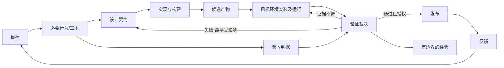

# R3-B 链路宇宙：从流程清单到可追溯的交接

任务 AI-NATIVE-RESEARCH-R3-B。原始目标：将不完整想法变为经真实验收的交付。B 只研究从输入到结果的关系、衔接、短路径、复用和回退；需求内部算法归 C，模型结构归 D，任务编排归 I，知识治理归 K。

## 1. 核心结论
R2 的15条专项链路保留为导航，原总链路不是每次都必经的流程。关键是区别不同边：
- 知识/推导（目标为何成立、需求为何必要、方案为何可行）：根据事实与假设提出主张，可能被证伪；箭头不是已执行动作。
- 业务/行为（触发、对象、状态、结果）：系统实际如何运转，允许分支、并发与循环。
- 工程执行（任务、实现、构建、运行）：有实际输入输出及回执。
- 验证与决策（需求对应测试、证据支持裁决、失败返回受影响环节）：不能用“存在测试”冒充“测试通过”。
- 生命周期与学习（安装、运营、反馈、复用、退役）：跨版本、状态与责任；新信息可能令旧决策失效。
跨链路最小交接是「上游主张/工件标识+版本、下游所需条件、可核对依据、失败时去哪里」。可以是一行文字或已有测试/commit链接，不强制使用图数据库或15份文档。NASA 双向追溯有助识别丢失需求、无来源功能和变更影响，但并不证明建立更多追溯文档必然有价值。

## 2. 15条链路：输入、节点、出口与回退
| R2链路（保留） | 输入→关键节点（边类型）→输出 | 通过/回退条件 |
|---|---|---|
| 目标推理 | 原话/现象→问题/价值/目标（推导）→可观察目标 | 目标无冲突或冲突已显式处理；不清回用户事实 |
| 需求推理 | 目标/约束→场景/能力/规则→候选需求及验收 | 每个必要需求可解释；冲突/遗漏回场景，细节由C |
| 业务建模 | 角色、对象、规则→触发/行为/状态（运行）→业务结果 | 正常/异常状态能解释；未知规则回需求 |
| 产品设计 | 需求与场景→用户旅程/交互候选→行为和UI方案 | 可操作且保留约束；失败回业务/需求 |
| 研究 | 未知→定向检索/源码/实验（证据）→证据支持或未决假设 | 足以改变决策或预算耗尽，未决显式保留；补来源 |
| 方案决策 | 目标/证据/约束→候选/权衡/可行性验证→选择或拒绝 | 关键约束满足；失败回研究/设计，保留撤销条件 |
| 技术设计 | 需求/已有系统→模块/接口/状态/数据→实现契约 | 接口、边界及质量可验收；不匹配回设计/需求 |
| 任务拆分 | 契约/依赖→可验收切片/依赖图→工作项 | 依赖无断点、每项有出口；冲突回架构；E负责细节 |
| 研发执行 | 工作项/环境→修改/构建/自检→版本化产物与日志 | 构建/定向回归，失败回具体任务/契约 |
| 测试验收 | 判据/同一候选→测试/证据/裁决→通过/阻断/修复 | 要求证据覆盖且身份匹配；失败回最早受影响节点 |
| 发布交付 | 已验证产物/权限→安装/实际执行/发布→回执 | 安装与运行身份对应，授权及发布门满足；否则不晋升 |
| 运营价值 | 使用/反馈→量化/分析→改进或保持 | 证据支持价值判断；不足补观测或回目标 |
| 问题解决 | 症状/版本→候选根因/区别实验→修复及回归 | 复现或明确不复现边界；不因无复现称修复 |
| 知识沉淀 | 证据/失败/经验→抽象适用条件及验证→复用资产 | 可检索、版本/边界和反例明确；过期回证据 |
| 生命周期 | 对象/版本/责任→维护/升级/迁移/退役→状态与交接 | 数据/权限/兼容性/回滚条件；失败回对应阶段 |
条件允许的跳过：文案小修不必重新做目标树/市场研究，但要有差量验收；同一机制可信且版本范围未变可复用先前事实；风险跨界则扩展。设计与测试判据可并行推演，代码与可执行测试必须用同一契约；验收身份依赖真实构建、安装与运行，不能前置宣告。

## 3. 跨链路关联（候选）

回退箭头是示意：需求错误回R，证据缺失回N或测试，代码错误回I，不一律回D。生产事故可先受控止损，不等待完整根因。变更后只失效受影响证据；若目标、版本、平台或行为不同，旧证据不得自动继承。

## 4. 真实需求追踪：AI Send Queue Ctrl+Enter
固定原始问题：「Ctrl+Enter将当前草稿加入队列，在回复生成时也可继续添加，按顺序发送，不误发。」用户的期望结果与源码现况必须分开。固定真实参考 2d98a00128cf77a7587f62729aee8d5a61a07c5a；历史报告 ACCEPTANCE-CTRL-ENTER.zh-CN.md 记录 2026-11-09 r16 候选而非当前版本的发布状态。
| 原始需求→设计契约 | 验收判据及真实来源 | 证据/缺口 |
|---|---|---|
| 可信快捷键进入共享 enqueue | 普通Enter/IME/编辑器更换/重复事件；报告L51-62 | 报告称 Node回归；原生键盘未测 |
| 发送一次、FIFO | 真实入站确认之前不重复触发；unknown不自动重放；shortcut-integration.test.mjs L148-211 | 当前源码有相应测试定义，历史报告有Node结果，不等同当前运行 |
| 草稿与会话保护 | 未确认飞行状态保留，切换会话不串发；报告L19-24,L58-60 | 无同候选真实站点回执 |
| 交付同一候选 | 0.1.15/r16 的 sourceHash、packageHash、安装及运行回执一致；报告L64-86 | 历史候选离线包已核，正式r15不等于r16；全测246/247；RELEASE_BLOCKED |
链路断点：候选构建→正式安装、安装→实际执行、真实执行→逐行为证据。禁止用r15历史FIFO或最新代码存在来填补r16历史证据。复用历史报告的事实，不宣称报告所称独立评分由本轮重新验证。该项目已有严格分层验收；本轮增益是提炼通用交接和可执行否决规则，不是声称发现项目之前未发现的发布阻断。

## 5. 局部缺陷短路径（桌面验证）
固定问题：「阅读目录边缘按钮疑似拦截滚动条。」已知源码包含安全边界，详见 A 的源码证据。短路径：症状/环境→已有代码与测试→区分几何与命中假设→受控复现/反例→仅修改受影响交互区→目标环境回归（滚动+按钮可用+折叠/展开）→同候选验收。无需重新推导全部商业、功能树、架构。若未能复现，输出假设与缺失环境而非“修复完成”；若实际根因是拖动中捕获丢失，回到诊断，不是继续扩大预留。
 
## 6. 实验与R2差量
R2 已有良好总链和15项；保留。修正：线性箭头需要类型、前置条件、工件版本、裁决和回退；合并跨链的重复节点（需求判据/验收证据共享唯一身份而非重复定义）；拒绝“15链全跑”“测试定义存在就是通过”“同名产品=同候选”。本轮已运行 trace_probe.py 八组确定性检查（一个历史案例、一个假设完整、六个单缺口变异）。详见 evidence.md。结果仅验证所定义的必要规则，不证明所有项目都需这一发布门或收益大小。
待研究：多类型真实任务（新功能、依赖集成、文案小修、失败修复）对照成本/漏项；实际端到端工件交接；独立评审。后续 I 可消费链路输入输出、短路径和回退，不能照抄整个15条成固定工作流。